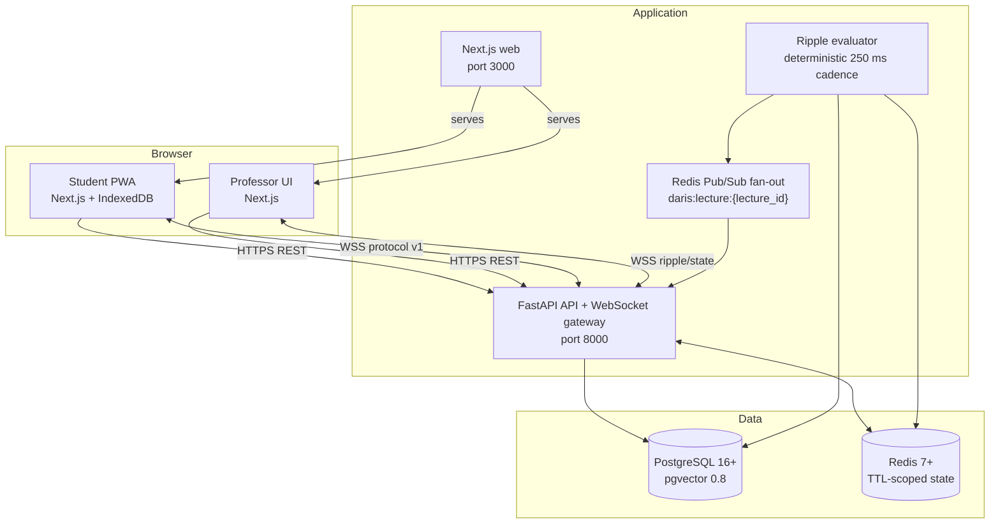
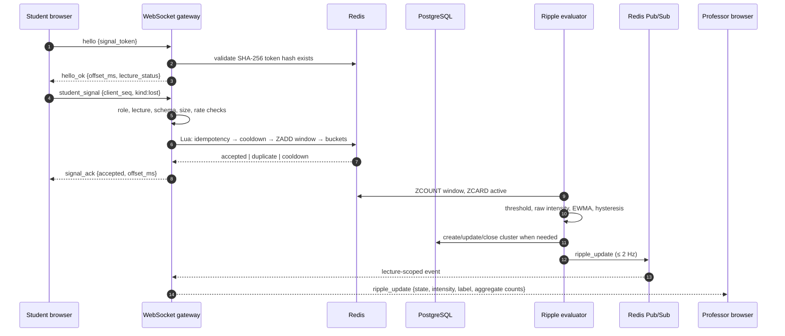
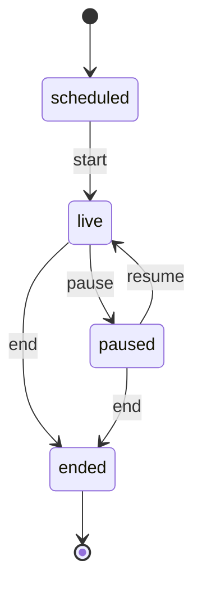
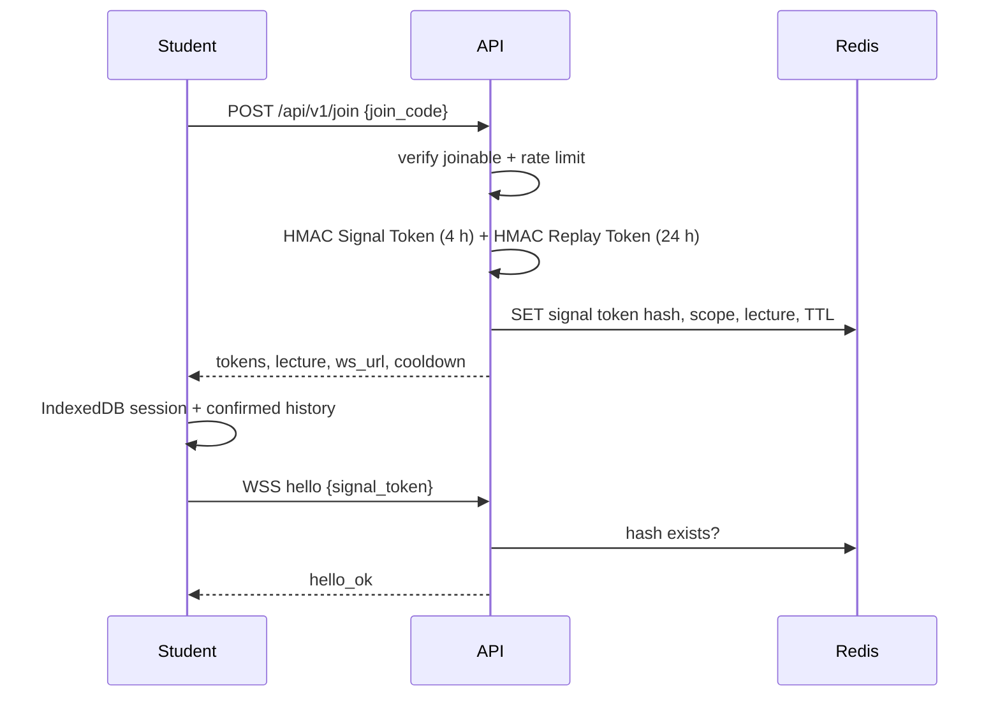
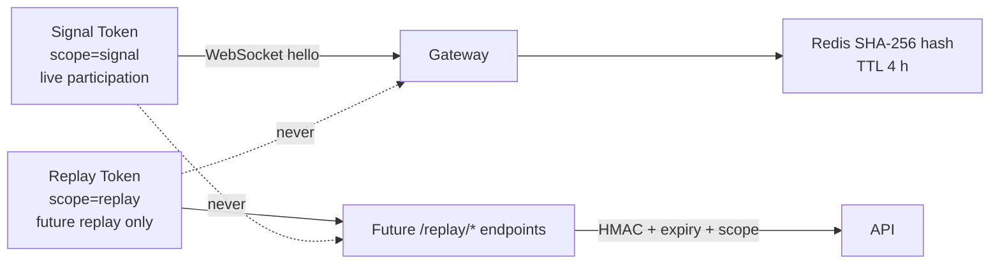
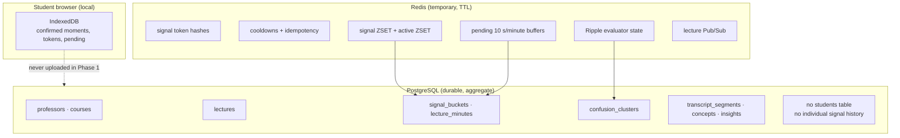
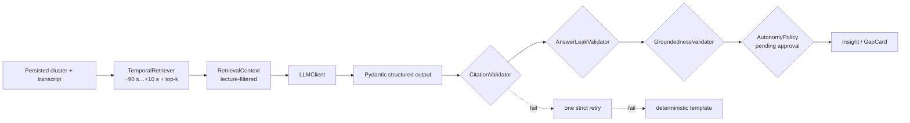

# DärisAI Architecture

This document describes the implementation that exists in this repository, not the full future product. Phase 1 is a modular monolith with two runtime containers and two stateful dependencies.

## 1. System containers

The web process is stateless. The API process holds open WebSocket connections, one Ripple evaluator loop and an in-process connection registry. Redis Pub/Sub carries events so multiple API processes can fan out, but the Phase 1 supported shape is **one API worker**; see [Limitations](#10-known-architecture-limitations).

## 2. Signal → acknowledgements → Ripple

The professor never receives student identifiers. Redis hashes and sliding-window members are temporary pseudonymous credentials, not database records.

## 3. Lecture lifecycle

- Only the owning professor can transition a lecture.
- `start` is valid only from `scheduled`.
- `pause` is valid only from `live`.
- `resume` is valid only from `paused`.
- `end` is terminal.
- `offset_ms` is authoritative active time: `(end − started_at − paused_total)`, where `end` is now, `paused_at`, or `ended_at`.
- Ending a lecture flushes metrics, finalizes an open cluster, updates aggregate counters and broadcasts `lecture_state: ended`.
- Student WebSockets are closed with code `4409`; new joins receive `409 LECTURE_NOT_LIVE`.

## 4. Student join and token lifecycle

The two scopes are cryptographically separated in the signed payload. The Replay Token is stateless so it can remain usable after the Signal Token hash has expired, but no replay endpoints are implemented in Phase 1.

## 5. Data boundaries

**PostgreSQL never receives:** student identity, raw Signal Tokens, individual signal rows, precise student→signal mappings.

**Redis temporarily receives:** SHA-256 token hashes, per-lecture members of the last 20 s window, active heartbeat members of the last 60 s, cooldown/idempotency keys and aggregate counters. All have TTLs.

**Browser keeps:** the raw temporary credentials, lecture metadata, confirmed offsets and the future GapCard store. Clearing site data deletes this history.

## 6. Redis key map

| Key pattern | Type / TTL | Purpose |
| --- | --- | --- |
| `daris:signal_token:{sha256}` | String, 4 h default | Signal Token authorization/revocation hash |
| `daris:cd:{lecture}:{token16}` | String, 15 s | Per-participant cooldown |
| `daris:idem:{lecture}:{token16}:{seq}` | String, 1 h | Duplicate suppression after reconnect |
| `daris:sig:{lecture}` | ZSET, 15 min | 20 s unique-signal window |
| `daris:active:{lecture}` | ZSET, 3 min | 60 s heartbeat window |
| `daris:bucket:*`, `daris:minute:*` | Hash/Set, 2 h | Pre-persistence aggregates |
| `daris:buckets:{lecture}`, `daris:minutes:{lecture}` | Set | Bucket flush registry |
| `daris:all_unique:{lecture}` | Set, 24 h | Exact overall unique-participant count |
| `daris:ripple_engine:{lecture}` | JSON, 6 h | EWMA/state/cluster runtime |
| `daris:ripple:{lecture}` | JSON, 6 h | Last broadcast snapshot |
| `daris:lecture:{lecture}` | Pub/Sub channel | Ripple/state fan-out |
| `daris:rl:*` | Integer, 60 s | Keyed IP rate limits |

Per-lecture isolation is enforced by key names, token claims and WebSocket lecture checks. A Signal Token for lecture A cannot authenticate against lecture B.

## 7. Ripple semantics

- Window: 20,000 ms.
- Active participants: unique tokens with heartbeat within 60,000 ms.
- Threshold: `max(3, ceil(0.15 × active))`.
- Raw intensity: `min(1, unique_in_window / (2 × threshold))`.
- Smoothing: EWMA with α = 0.4, evaluated once per 250 ms tick.
- Broadcast: at most twice per second; state changes, intensity deltas ≥ 0.02, or a changed unique-window count.
- States: `connected`, `rising`, `cluster`, `recovering`.
- Cluster needs five seconds of raw intensity ≥ 0.5 and EWMA ≥ 0.35.
- Recovery closes the cluster below 0.35; it returns to connected after sustained recovery.
- Small groups never create a cluster (`active < 3`). They are labelled **insufficient participation**, not "understanding".
- Silence is labelled **few signals**, never "everyone understands".
- At most aggregate counts appear in the professor's optional details; no individual histories.

The pure engine is in [`backend/app/realtime/ripple.py`](backend/app/realtime/ripple.py) and is independently testable.

## 8. Persistence and bucket semantics

- Signals increment Redis buffers for the current 10 s bucket and 60 s minute.
- The evaluator flushes completed buckets asynchronously.
- `lecture_minutes.unique_tokens` is a distinct count within that minute, not a sum of per-10-second unique counts.
- `lectures.unique_participants` is the distinct count over the whole lecture, retained from a temporary Redis set at finalization.
- `confusion_clusters.unique_tokens` is the distinct count observed across the cluster's lifetime.
- `peak_intensity` is a signal-intensity aggregate, not a comprehension score.
- `finalize_lecture` flushes all remaining buckets, closes open clusters and updates aggregate counters.

## 9. Future Axiom integration

Interfaces exist in `backend/app/axiom/interfaces.py` and domain models in `backend/app/axiom/models.py`. **No LLM or embedding provider is called in Phase 1.** Grounded generation reduces hallucination risk; it does not make a model incapable of error. The future design requires teacher supervision and explicit approval.

## 10. Known architecture limitations

- Single API worker is the supported shape. Ripple evaluator state is loaded from Redis, and Pub/Sub fan-out is present, but concurrent workers can evaluate with stale in-process state. The advisory eval lock reduces overlap; it does not make evaluator state fully distributed.
- WebSocket close and fan-out are best effort. A disconnected professor receives the cached last snapshot on reconnect.
- Redis loss during a live lecture makes new joins and signal processing fail safely; the API does not fabricate an acknowledgement.
- Exact unique counts across long time ranges require temporary sets; only aggregated counts are persisted.
- A six-character join code is human-friendly and guessable in principle. Join rate limits, code rotation policy and classroom context are the Phase 1 mitigations; code rotation UI is deferred.
- No cloud deployment was executed. Compose is the reproducible target.
- The service worker caches only the app shell and offline page. It never caches API responses or credentials.

## 11. Scaling path

1. Run one evaluator worker with a Redis lease and publish snapshots; keep WebSocket workers stateless beyond the local connection registry.
2. Shard Pub/Sub channels by `lecture_id` if a single Redis instance becomes a bottleneck.
3. Move bucket flushing to a dedicated worker queue with idempotent upserts.
4. Add read replicas for professor analytics; keep writes on the primary.
5. Store transcript embeddings in pgvector with HNSW; enforce `lecture_id` in SQL.
6. Add Redis Cluster only when the measured single-instance capacity is exhausted; the current "clustering" refers to signal density, not Redis Cluster.
