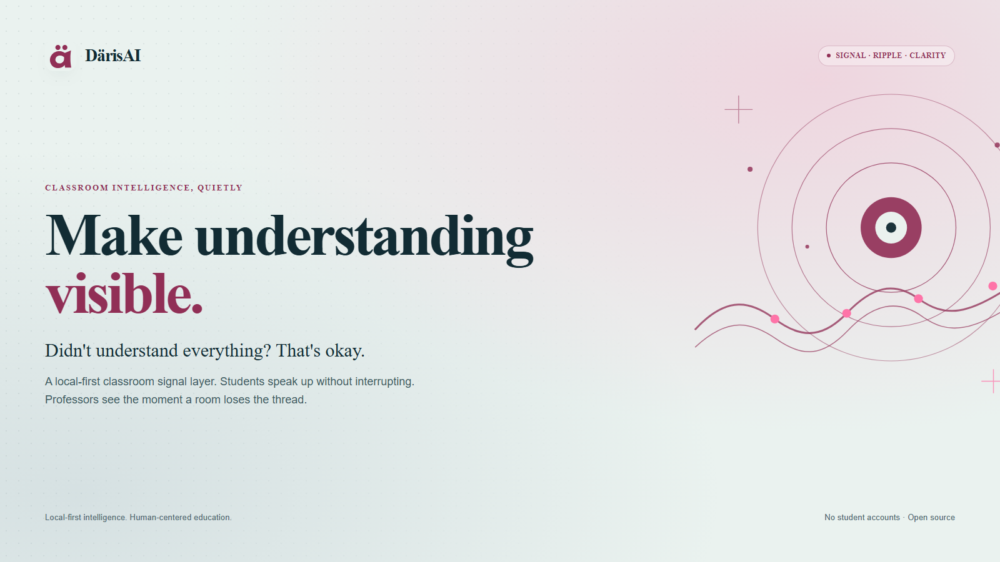
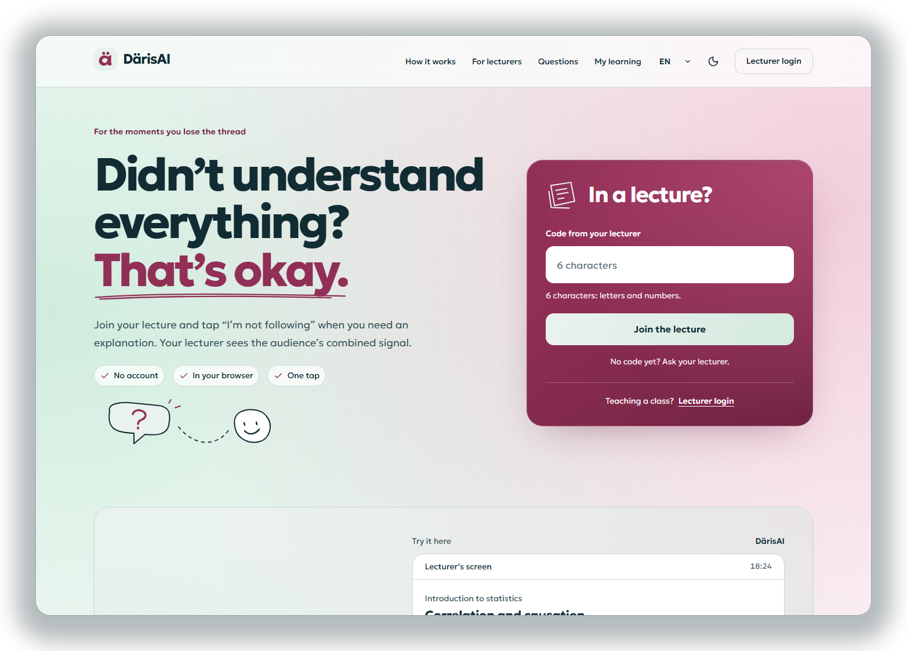
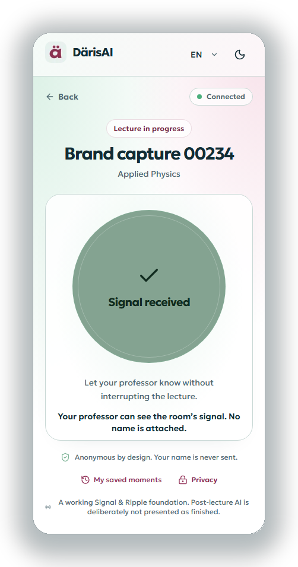
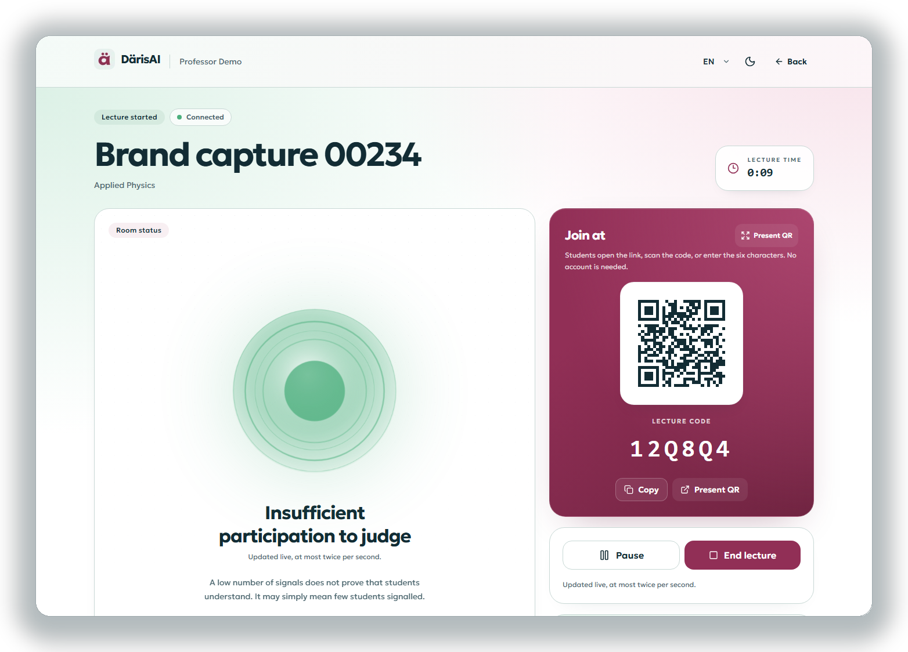
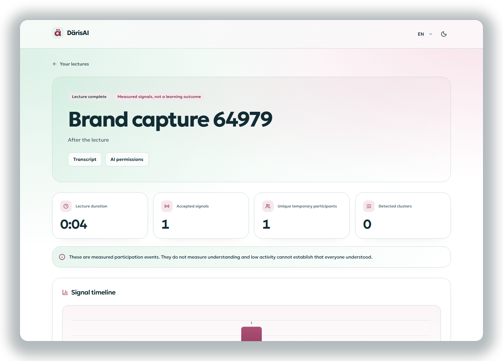
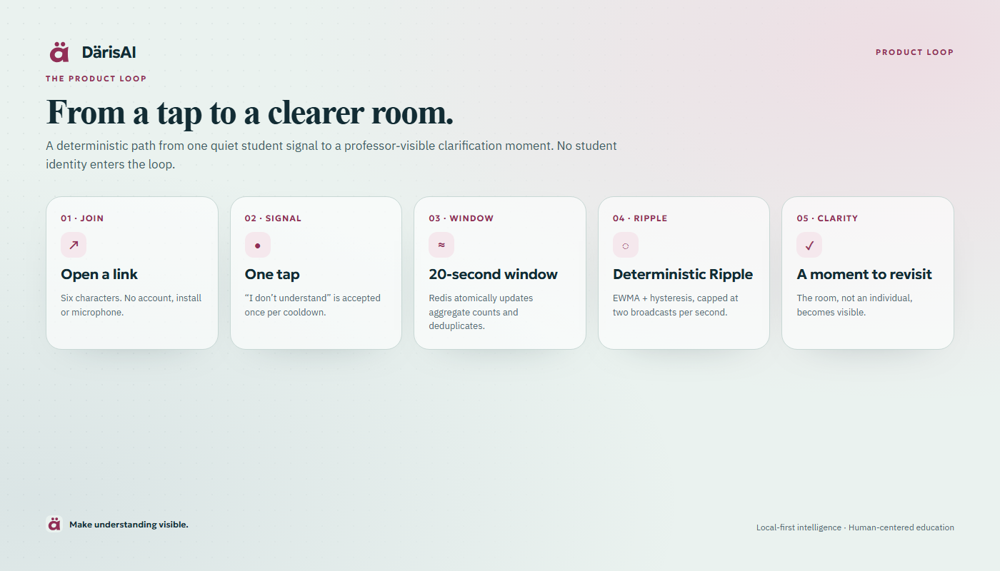
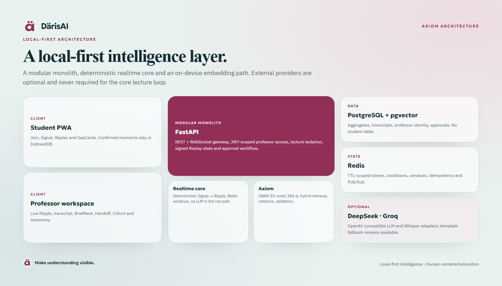
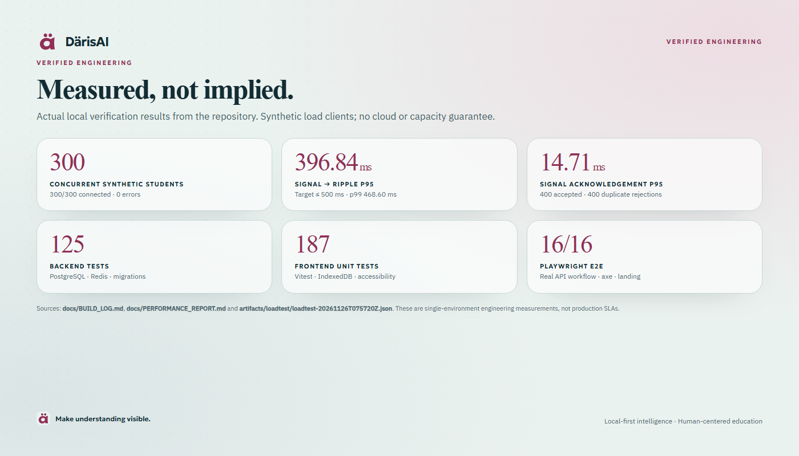

<div align="center">

<picture>
  <source media="(prefers-color-scheme: dark)" srcset="brand/readme/hero-dark.png">
  
</picture>

### Түсінбей қалдың ба? Ондай болады.

[English](README.md) · [Русский](README.ru.md) · **Қазақша**

[](https://github.com/Nurzhigittt/project-darisai/actions)
[](https://github.com/Nurzhigittt/project-darisai/actions)


**Жергілікті интеллект. Адамға бағытталған білім.**

</div>

---

## Аудиторияны тыныш түсіну

DärisAI — студент түсіндірудің байланысын жоғалтқан сәтке арналған Classroom Intelligence қабаты.

Студент сілтемені ашады, алты таңбаны енгізеді және түсіндіру қажет болғанда **«Түсінбеймін»** батырмасын басады. Оқытушы чатты, рейтингті немесе студент профилін емес, тыныш жиынтық Ripple көреді.

Студент аккаунттары жоқ. Микрофон жоқ. Жеке сигнал тарихы жоқ.

| Студенттер үшін | Оқытушылар үшін | Құпиялылық үшін |
| --- | --- | --- |
| Бір сілтеме. Бір басу. Тіркелу немесе орнату жоқ. | Аудиторияның анық сигналы. Дәрістен шықпай кідірту, жалғастыру және сол сәтке оралу. | Тек жиынтық оқиғалар. Расталған сәттер студенттің браузерінде қалады. Тұрақты жеке дерек — тек оқытушының тұлғасы. |

## Қалай көрінеді

Бұл — жергілікті синтетикалық демо-жүгірістен алынған нақты production-скриншоттар. Аттар, дәріс атаулары мен сандар — сынақ деректері.

<table>
<tr>
<td width="60%"><br /><sub>Код арқылы кіру, аккаунтсыз.</sub></td>
<td width="40%"><br /><sub>Бір тыныш әрекет және жергілікті растау.</sub></td>
</tr>
<tr>
<td><br /><sub>QR, код және жиынтық Ripple.</sub></td>
<td><br /><sub>Нақты жиынтықтар, түсінуді бағалау емес.</sub></td>
</tr>
</table>

## Өнім циклі



Нақты жол детерминді: **Redis 20 секундтық терезе → EWMA α = 0.4 → гистерезис → секундына 2 трансляциядан аспайды**. LLM Signal → Ripple жедел жолында емес.

## Жергілікті архитектура



- **Axiom** — нақты `multilingual-e5-small` ONNX эмбеддингтері, 384 өлшем, CPU; dense + BM25 + RRF + temporal гибридті іздеу.
- **Негізделген генерация** — дәйексөздер, groundedness, жауаптың ағып кетуінен және prompt injection-нан қорғау.
- **Провайдерлер** — DeepSeek және Groq міндетті емес; шаблондық fallback `source=template` деп ашық белгіленеді.
- **Құпиялылық** — студент кестесі, тұрақты диалогтар және шикі аудио жоқ.

## Тексерілген



| Тексеру | Нақты жергілікті нәтиже |
| --- | --- |
| Backend | **126 тест** · Ruff және mypy таза |
| Frontend | **188 unit-тест**, 17 файл |
| Playwright | **16/16 E2E**, нақты Signal → Ripple және axe қоса |
| Signal acknowledgement | p95 **14.71 мс** |
| Signal → Ripple | p95 **396.84 мс**, p99 468.60 мс |
| Жүктеме | 300/300 клиент · **0 қате** |
| Production build | Сәтті |

Бұл — бір жергілікті ортаның өлшемдері, SLA емес. Docker және бұлт жергілікті іске қосылмады.

## Жылдам бастау

```bash
cp .env.example .env

cd backend
python -m venv .venv
python -m pip install -e ".[dev]"
python -m app.migrate
python -m app.seed
python -m uvicorn app.main:app --host 127.0.0.1 --port 8000
```

```bash
cd frontend
pnpm install --frozen-lockfile
pnpm dev
```

<http://localhost:3000> ашыңыз, **`DARIS-TEACH-2026`** dev-кодын қолданып, дәріс жасаңыз. Толық жол — [онбордингте](docs/ONBOARDING.md).

## Құжаттама

- [Архитектура](ARCHITECTURE.md) · [API](docs/API_CONTRACTS.md) · [Дерекқор](docs/DB_SCHEMA.md)
- [Қауіпсіздік және құпиялылық](docs/SECURITY_PRIVACY.md)
- [P1 frontend](docs/handover/P1.md) · [P2 backend](docs/P2_HANDOVER.md) · [P3 Axiom](docs/P3_HANDOVER.md)
- [Онбординг](docs/ONBOARDING.md) · [Жергілікті AI](docs/LOCAL_AI.md) · [Провайдерлер](docs/AI_PROVIDER_SETUP.md)
- [Бренд](docs/BRAND.md) · [Build log](docs/BUILD_LOG.md)

## Құпиялылық

Signal Token — псевдонимдік, бірақ абсолютті анонимдік емес: оны бар кез келген адам мерзімі бітпейінше қолдана алады. Сервер тек токен хэштерін Redis-те сақтайды, PostgreSQL-де емес. Студент аккаунты, аты, email, телефоны, device ID немесе жеке сигнал тарихы жоқ. Расталған сәттер студенттің IndexedDB-інде сақталып, жергілікті жойылады.

## Бренд

Ресми палитра: **Mint Cream `#EAF2EF`**, **Vintage Berry `#912F56`**, **Jet Black `#122C34`**, **Yale Blue `#224870`**, **Rose Kiss `#FF70A6`**. Ресми белгі — Mint Cream фонындағы Vintage Berry түсті кіші **ä**. Оны generic AI белгісімен ауыстырмаңыз.

## Мәртебе және шектеулер

- ✅ Негізгі дәріс циклі, Replay, GapCards, BriefNext/Handoff, Cohort және автономдылық іске асырылып, тексерілді.
- ✅ DeepSeek/Groq live тексерулері өтті; шаблондық fallback сақталған.
- ⚠️ Кең live adversarial қауіпсіздік тексеруі және оқу нәтижелерін зерттеу мәлімделмейді.
- ⚠️ Деплой, бұлт, multi-worker және нақты құрылғыларда screen reader аудиті жоқ.
- ⚠️ P4 40 студенттік симулятор мен 90 секундтық демонстрацияға жауапты.

<div align="center"><sub>DärisAI · Жергілікті интеллект. Адамға бағытталған білім.</sub></div>
