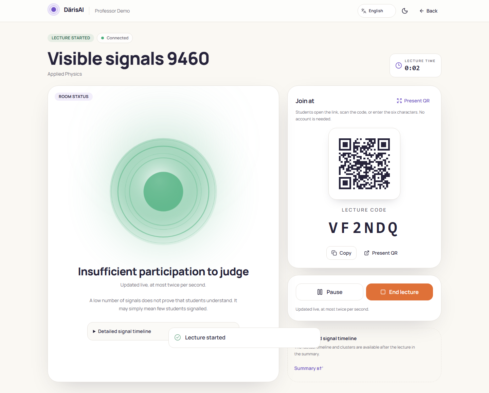
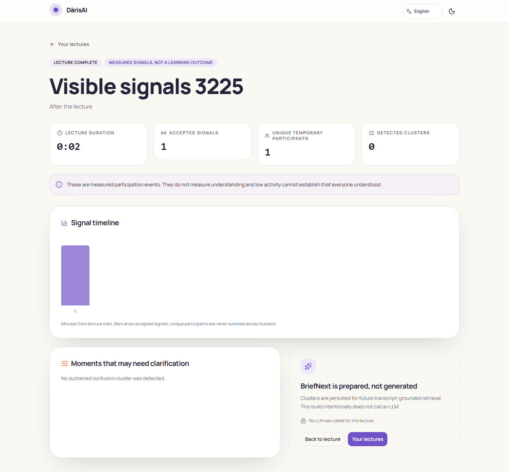
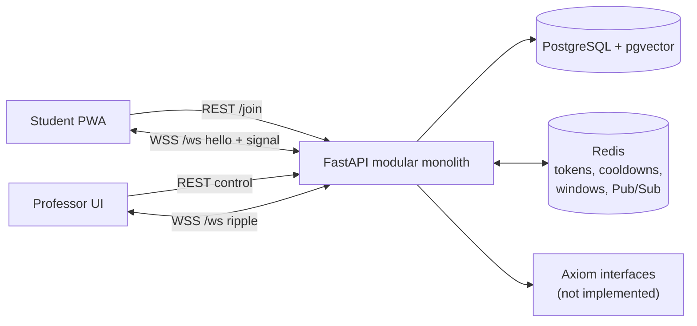

# DärisAI

**Make understanding visible.**

DärisAI is a quiet, anonymous lecture feedback system. Students join with a six-character code, press one large **I don't understand** button when they lose the thread, and the professor sees a calm, real-time Ripple instead of a leaderboard or a chat feed.

This repository is the working **Phase 0 foundation + Phase 1 Signal & Ripple vertical slice**. It runs through real PostgreSQL, Redis, REST, WebSockets and browser persistence. The post-lecture AI ecosystem is deliberately **not** presented as finished.



## What is real

- Real FastAPI application with typed settings, request IDs, structured logs, readiness probes, CORS and security headers.
- Real PostgreSQL schema with `pgvector`, UUID keys, raw SQL migrations, aggregates and privacy checks.
- Real Redis keys for temporary credentials, cooldowns, idempotency, sliding windows, active participants and Pub/Sub.
- Real anonymous student join with separately scoped **Signal** and **Replay** tokens.
- Real authenticated WebSocket gateway with hello timeout, role checks, lecture isolation, heartbeats, rate limits and close codes.
- Real atomic signal processing (Lua) with cooldown and duplicate rejection.
- Real deterministic Ripple algorithm (20 s window, active-participant threshold, EWMA α = 0.4, hysteresis and 2 Hz broadcast cap).
- Real confusion clusters persisted in PostgreSQL.
- Real IndexedDB student history containing only signals confirmed by the server.
- Real professor controls, QR presentation mode, factual heatmap/summary and PWA shell.
- Real automated tests and an end-to-end Playwright workflow.

## What is intentionally not finished

- Production speech-to-text.
- Temporal RAG, Axiom LLM calls, Socratic Replay, GapCards, BriefNext, Handoff, Cohort Memory and Staged Autonomy.
- A 90-second judge demo simulator.
- Cloud deployment. Local Compose is provided but was not executed in the build environment (Docker was unavailable); see [the handover](docs/HANDOVER.md).

No paid provider credentials are required. The application has no LLM dependency in Phase 1.

## Screens

| Landing | Student Signal | Student summary/history |
| --- | --- | --- |
|  |  |  |

More screenshots: [privacy](docs/screenshots/privacy.png), [status](docs/screenshots/status.png).

## Stack

**Frontend:** Next.js 16 App Router, React 19, TypeScript strict, Tailwind CSS, Lucide, IndexedDB (`idb`), native WebSocket, PWA service worker, Vitest and Playwright.

**Backend:** Python 3.12+, FastAPI, Pydantic v2, Pydantic Settings, asyncpg, redis-py asyncio, native WebSockets, pytest, Hypothesis, Ruff and mypy.

**Infrastructure:** PostgreSQL 16+ with pgvector, Redis 7 (Redis 5 compatible commands are used), Docker Compose, GitHub Actions.

## Architecture at a glance



See [ARCHITECTURE.md](ARCHITECTURE.md) for sequence diagrams and data boundaries.

## Quick start with Docker

```bash
cp .env.example .env
docker compose up --build
```

- Web: <http://localhost:3000>
- API: <http://localhost:8000>
- API docs: <http://localhost:8000/docs>
- Readiness: <http://localhost:8000/ready>

The development professor invite code is `DARIS-TEACH-2026` unless you change `SEED_PROFESSOR_INVITE_CODE` in `.env`. It is a development fixture, not a production credential.

> Docker was not available in the execution environment used to build this repository. The Compose files are provided and reviewed, but the clean-clone Docker path remains **unverified locally**; see `docs/BUILD_LOG.md`.

## Quick start without Docker (verified locally)

Prerequisites: Python 3.12+, Node 24, pnpm, PostgreSQL 18 with pgvector, Redis 5+.

```bash
cp .env.example .env
# Point DATABASE_URL and REDIS_URL at your local services.
# The example defaults are port 55432 for PostgreSQL and 6379 for Redis.

cd backend
python -m venv .venv
./.venv/Scripts/python -m pip install -e ".[dev]"   # Windows PowerShell
# source .venv/bin/activate && pip install -e ".[dev]"  # Unix
python -m app.migrate
python -m app.seed
python -m uvicorn app.main:app --host 127.0.0.1 --port 8000
```

In a second terminal:

```bash
cd frontend
pnpm install --frozen-lockfile
pnpm dev
```

The local verification used PostgreSQL on `127.0.0.1:55432` and Redis on `127.0.0.1:6379`. These ports are examples; set your own URLs.

## Environment

All configuration is environment-driven. Never commit `.env`.

| Variable | Purpose |
| --- | --- |
| `ENVIRONMENT` | `development`, `test` or `production`. Production rejects example secrets and requires HTTPS. |
| `APP_BASE_URL` | Public frontend origin used to build QR/join links. |
| `PUBLIC_WS_URL` | WebSocket URL returned by `POST /join`. |
| `DATABASE_URL` / `TEST_DATABASE_URL` | PostgreSQL DSNs. |
| `REDIS_URL` | Redis DSN. |
| `JWT_SECRET` | HS256 professor access-token signing key. |
| `TOKEN_SIGNING_SECRET` | HMAC key for student Signal/Replay tokens and invite hashes. |
| `RATE_LIMIT_SECRET` | Key for pseudonymous IP rate-limit counters. |
| `AUTO_SEED` | Development-only professor/course seeding. Must be false in production. |
| `SEED_PROFESSOR_INVITE_CODE` | Development fixture invite code. |
| `NEXT_PUBLIC_API_URL` | Browser-visible REST base URL. |
| `NEXT_PUBLIC_WS_URL` | Browser-visible WebSocket URL. |
| `NEXT_PUBLIC_APP_URL` | Frontend metadata origin. |

Generate production secrets with `openssl rand -hex 32`.

## Developer commands

Windows users without `make` can run the equivalent commands in the table.

| Command | Equivalent |
| --- | --- |
| `make up` | `docker compose up --build` |
| `make down` | `docker compose down` |
| `make logs` | `docker compose logs -f --tail=200` |
| `make migrate` | `cd backend && python -m app.migrate` |
| `make seed` | `cd backend && python -m app.seed` |
| `make test` | `cd backend && python -m pytest -q` then `cd frontend && pnpm test` |
| `make lint` | `cd backend && ruff check app tests` then `cd frontend && pnpm lint` |
| `make typecheck` | `cd backend && mypy app` then `cd frontend && pnpm typecheck` |
| `make contracts` | `python scripts/export_schemas.py` then `cd frontend && pnpm contracts` |
| `make e2e` | `cd frontend && pnpm e2e` |
| `make smoke` | `cd backend && python ../scripts/smoke.py` |
| `make loadtest` | `cd backend && python ../scripts/loadtest.py --students 30 --duration 20` |

## How the workflow works

1. A professor authenticates with an invite code and creates a lecture under a course.
2. The server allocates a unique six-character Crockford base32 join code and returns a join URL for QR rendering.
3. A student joins without an account and receives:
   - a short-lived **Signal Token** for WebSocket participation;
   - a longer-lived **Replay Token** reserved for future post-lecture learning.
4. The student connects to `/ws`, sends `hello` with the Signal Token inside the encrypted WebSocket payload, and waits for `hello_ok`.
5. During a live lecture, a signal travels through authentication, lecture authorization, schema validation, per-connection rate limiting, Redis idempotency/cooldown, atomic window aggregation and Ripple calculation.
6. The professor receives server-timestamped `ripple_update` events at most twice per second.
7. Sustained intensity creates one persisted confusion cluster; recovery closes it.
8. Ending the lecture flushes aggregate buckets, finalizes clusters and blocks further live signals.
9. The student sees only locally confirmed moments. PostgreSQL never receives an individual student signal history.

## API and contracts

REST and WebSocket schemas are exported from Pydantic models:

- [`docs/contracts/openapi.json`](docs/contracts/openapi.json)
- [`docs/contracts/ws-events.schema.json`](docs/contracts/ws-events.schema.json)
- [`frontend/src/lib/api/types.gen.ts`](frontend/src/lib/api/types.gen.ts)
- Fixtures: [`docs/contracts/fixtures/`](docs/contracts/fixtures/)

CI fails when generated contracts drift from committed ones. See [docs/API_CONTRACTS.md](docs/API_CONTRACTS.md).

## Testing

```bash
cd backend
pytest -q

cd ../frontend
pnpm test
pnpm e2e
```

Verified locally on 25 November 2026:

- Backend: **37 passed** (25 unit, 9 integration, 3 security), real PostgreSQL + Redis.
- Frontend: **11 passed**.
- Playwright: **7 passed**, including the full professor/student workflow and automated axe checks on four public screens.
- Ruff, mypy, ESLint, TypeScript and gitleaks: clean locally.
- Production frontend build: successful.
- Load test: **300 / 300** synthetic students connected, zero errors, signal-to-Ripple p95 **493 ms**, acknowledgement p95 **11 ms**. See [docs/PERFORMANCE_REPORT.md](docs/PERFORMANCE_REPORT.md).

## Privacy in one paragraph

There is no student account, no student table, no student name, email, phone, device identifier or individual signal history in PostgreSQL. Temporary Signal and Replay credentials are pseudonymous, lecture-scoped and time-limited. The server stores only a SHA-256 Signal Token hash in Redis for authorization, deduplication and cooldown. Confirmed student moments stay in IndexedDB on their device. Professor identity is the only persistent personal data. Read the live manifest at `/api/v1/privacy/manifest` or the plain-language page at `/privacy`.

A token is pseudonymous, not proof of absolute anonymity: whoever holds it can act as that participant until it expires, and the same person can join from multiple browsers/devices.

## Accessibility and localisation

- WCAG 2.2 AA target: semantic landmarks, keyboard navigation, visible focus, ARIA live status text, 44 px+ targets, reduced-motion fallbacks and text alternatives to colour.
- English, Russian and Kazakh dictionaries are separate from business logic.
- Light mode is the default; a low-light theme is available.
- The Signal button always uses words, not colour alone.

## Security

- HMAC-signed, scoped student tokens; JWT professor sessions with issuer/audience/expiry checks.
- Constant-time comparisons; invite codes stored as keyed hashes.
- Origin validation, CORS allowlist, message-size limits, per-connection rate limiting and Redis TTLs.
- No raw tokens, IPs or request bodies in application logs.
- See [SECURITY.md](SECURITY.md) and [docs/SECURITY_PRIVACY.md](docs/SECURITY_PRIVACY.md).

## Repository map

```text
backend/   FastAPI app, SQL migrations, tests
frontend/  Next.js App Router app, design system, PWA, unit/E2E tests
docs/      audit, API/DB/security docs, ADRs, contracts, reports, handover
scripts/   contract export, icons, smoke test, load test
.github/   CI, E2E and secret scanning
```

## Contribution workflow

- Trunk-based; feature branches such as `feat/phase-2-axiom`.
- Conventional Commits; do not rewrite shared history or force-push.
- Run `make lint`, `make typecheck`, `make test`, `make contracts` before pushing.
- Additive contract changes after the baseline; regenerate rather than hand-edit `types.gen.ts`.
- Never add a student identity table or fabricate a metric/test result.
- Preserve the privacy allowlist and CI privacy test.

## Documentation

- [Specification audit](docs/SPEC_AUDIT.md)
- [Architecture](ARCHITECTURE.md)
- [Database schema](docs/DB_SCHEMA.md)
- [API contracts](docs/API_CONTRACTS.md)
- [Security & privacy](docs/SECURITY_PRIVACY.md)
- [ADRs](docs/adr/)
- [Build log](docs/BUILD_LOG.md)
- [Performance report](docs/PERFORMANCE_REPORT.md)
- [Roadmap](docs/ROADMAP.md)
- [Handover](docs/HANDOVER.md)
- [Agent instructions](AGENTS.md)

## Limitations

- One API worker is the supported Phase 1 deployment shape. Redis Pub/Sub is in place, but Ripple runtime state is cached per process; multi-worker coordination is future work.
- No production STT; transcript tables and Axiom interfaces exist without live ingestion.
- Share profiles are browser-scoped: clearing site data removes local study history; joining from several devices creates independent participants.
- A low number of signals does **not** prove understanding.
- Docker Compose, GitHub Actions and cloud deployment were not executable in the local build environment. Their configuration is committed; verification status is reported honestly in the handover.
