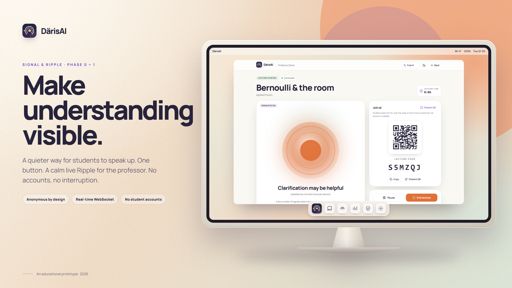
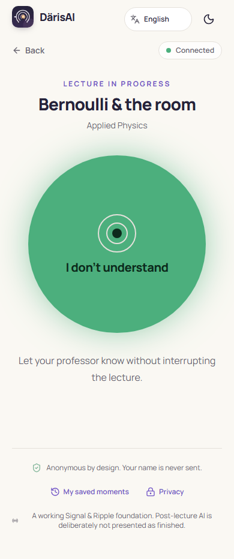
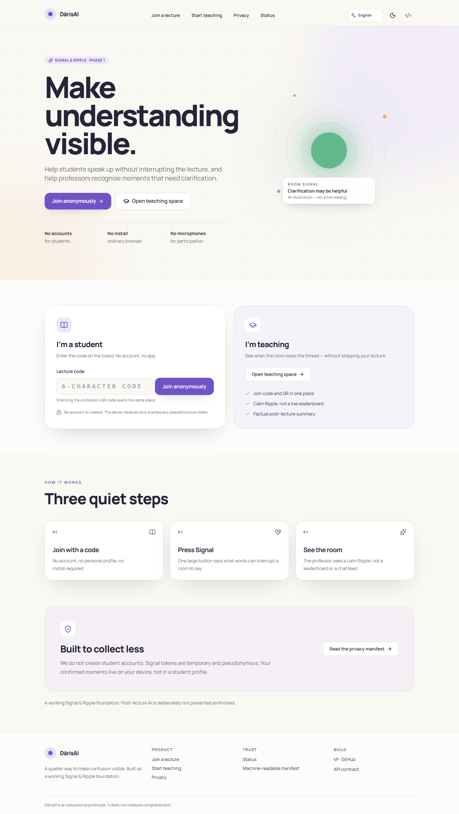
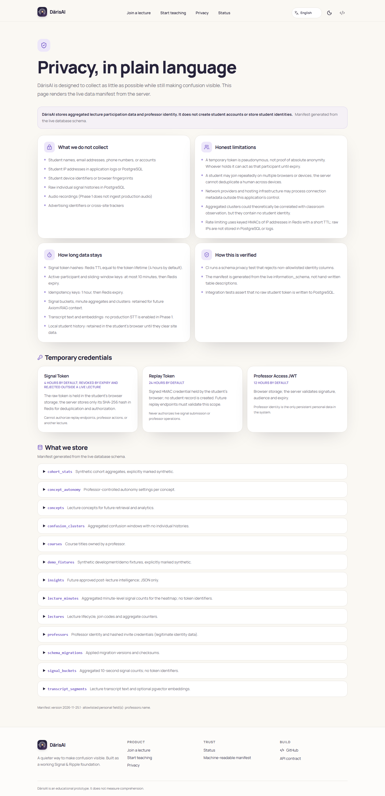
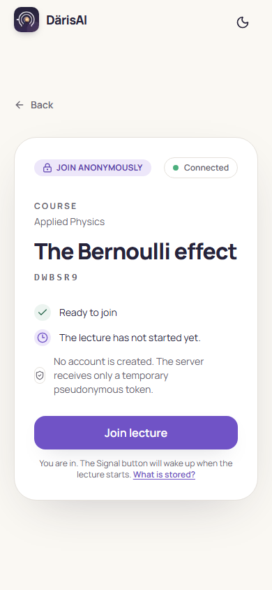
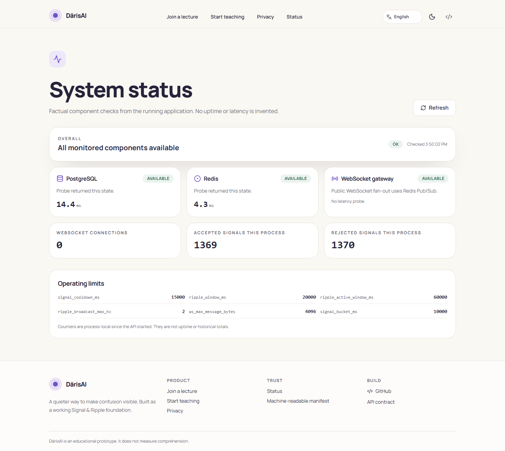
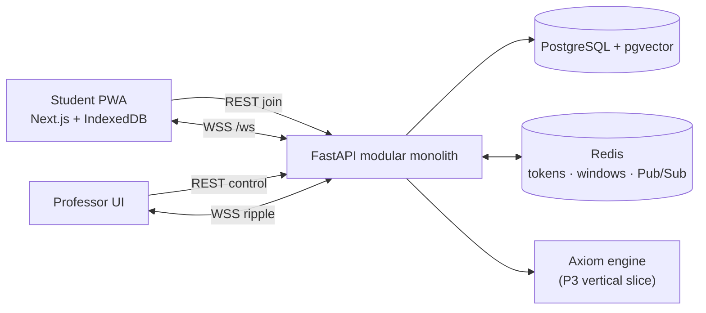

<div align="center">


# DärisAI

### Make understanding visible.

A quieter way for students to speak up, and for professors to notice the moment a room loses the thread.

**No student accounts · No interruption · Real-time Ripple**

[English](README.md) · [Русский](README.ru.md)

[](https://github.com/Nurzhigittt/project-darisai/actions)
[](https://github.com/Nurzhigittt/project-darisai/actions)


</div>



<div align="center">
  <sub>An actual production-build screenshot from the working app, set in an original desktop composition.</sub>
</div>

---

## Why it feels different

Most classroom tools ask for attention. DärisAI asks for a single tap.

<table>
<tr>
<td width="33%" valign="top">

### For students

Open a link. Enter six characters. Press **I don’t understand** when the thread disappears.

No account. No app install. No microphone. No name attached.

</td>
<td width="33%" valign="top">

### For professors

A calm Ripple in the corner of the room — not a leaderboard, a chat feed, or another dashboard to manage.

Pause, resume or end the lecture without leaving the screen.

</td>
<td width="33%" valign="top">

### For privacy

There is no student table. Temporary credentials are lecture-scoped and pseudonymous. Confirmed moments stay in the student’s browser.

Professor identity is the only persistent personal data.

</td>
</tr>
</table>

## What it looks like

<table>
<tr>
<td width="58%">
  
  <br />
  <sub><strong>Professor view</strong> — a cluster is visible as a warm Ripple, with no individual histories.</sub>
</td>
<td width="42%">
  
  <br />
  <sub><strong>Student view</strong> — one dominant action, readable status, no account.</sub>
</td>
</tr>
</table>

<table>
<tr>
<td width="50%">
  
  <br />
  <sub><strong>After the lecture</strong> — factual aggregate signals and cluster timestamps, not inferred learning outcomes.</sub>
</td>
<td width="50%">
  
  <br />
  <sub><strong>QR presentation</strong> — a projector-friendly join surface with the real configured origin.</sub>
</td>
</tr>
</table>

<details>
<summary><strong>More screens</strong></summary>
<br />
<table>
<tr>
<td width="50%"></td>
<td width="50%"></td>
</tr>
<tr>
<td></td>
<td></td>
</tr>
</table>
</details>

## The loop

```text
Professor starts a lecture
        ↓
Student joins with a 6-character code — no account
        ↓
Student presses Signal
        ↓
FastAPI validates token, lecture, schema, rate, cooldown and duplicate
        ↓
Redis Lua updates an atomic 20-second window
        ↓
Deterministic Ripple evaluation (EWMA + hysteresis, ≤ 2 updates/sec)
        ↓
Professor sees a calm state: rising · cluster · recovering
        ↓
Clusters are persisted; ending the lecture freezes the aggregate
```

The student’s confirmed moments live in **IndexedDB on their device**. The server never receives an individual student signal history.

## Architecture



- **Signal Token** — short-lived, lecture-scoped, live participation only.
- **Replay Token** — longer-lived, signed, Replay/GapCards only; never authorizes live signals.
- **Redis** — hashes, cooldowns, idempotency and sliding windows, all TTL-scoped.
- **PostgreSQL** — aggregate buckets, clusters and professor identity; no student rows.
- **One API worker** is the supported Phase 1 shape. This is stated plainly in the handover.

[Full architecture and sequence diagrams →](ARCHITECTURE.md)

## Quick start

### Docker

```bash
cp .env.example .env
docker compose up --build
```

- Web: <http://localhost:3000>
- API: <http://localhost:8000>
- API docs: <http://localhost:8000/docs>
- Readiness: <http://localhost:8000/ready>

> [!NOTE]
> Docker was not available in the environment where this slice was verified. The Compose files are committed, but the Docker path is **not claimed as locally tested**. See the [handover](docs/HANDOVER.md).

### Local — verified

Requirements: Python 3.12+, Node 24, pnpm, PostgreSQL 16+ with `pgvector`, Redis 5+.

```bash
cp .env.example .env

cd backend
python -m venv .venv
# Windows: .\.venv\Scripts\python -m pip install -e ".[dev]"
# Unix:    source .venv/bin/activate && pip install -e ".[dev]"
python -m app.migrate
python -m app.seed
python -m uvicorn app.main:app --host 127.0.0.1 --port 8000
```

```bash
cd frontend
pnpm install --frozen-lockfile
pnpm dev
```

## Create your first lecture

1. Open **`/login`**.
2. Use the development invite code **`DARIS-TEACH-2026`**  
   (from `SEED_PROFESSOR_INVITE_CODE`; development only).
3. Choose a course, lecture title and language.
4. DärisAI generates the **six-character join code** and QR URL.
5. Students open the URL or enter the code. No student account is created.

The professor does **not** invent the join code. The QR uses `APP_BASE_URL`, so set that to the real application origin before creating a lecture in any deployment.

If the invite code is rejected, run the migration and seed again:

```bash
cd backend
python -m app.migrate
python -m app.seed
```

## Verified, not implied

| Check | Actual result |
| --- | --- |
| Backend tests | **37 passed** against real PostgreSQL + Redis |
| Frontend tests | **11 passed** |
| End-to-end | **7 passed** — full lecture workflow, invalid code, keyboard/localization, 4 axe scans |
| Lint & types | Ruff, mypy, ESLint and TypeScript clean |
| Production build | Successful Next.js build |
| 300-client load test | 300/300 connected, **0 errors**, ack p95 **11 ms**, Ripple p95 **493 ms** |
| Multi-lecture load | 60 students / 3 lectures, **0 errors**, Ripple p95 **487 ms** |
| Secrets | gitleaks clean locally |
| Docker / remote CI | **Configured, not executed here** |

The 493 ms p95 is only 6.75 ms below the engineering target; p99 is above 500 ms. The [performance report](docs/PERFORMANCE_REPORT.md) includes the environment, methodology and limitations.

## What is real

- Professor invite auth, lecture lifecycle and pause/resume timing.
- Anonymous join with separately scoped Signal and Replay tokens.
- Real authenticated WebSocket gateway with origin checks, hello timeout, rate limits and close codes.
- Atomic Redis signal processing with duplicate and cooldown rejection.
- Deterministic Ripple with hysteresis, small-group policy and 2 Hz cap.
- Persisted confusion clusters and factual minute-level analytics.
- Student IndexedDB history of server-confirmed signals.
- QR presentation, post-lecture summary, privacy manifest, status page.
- Accessible design system, EN/RU/KK, light/dark theme and PWA app shell.
- Real 384-d ONNX E5 embeddings, timestamped transcript ingestion, lecture-isolated hybrid retrieval (dense + BM25 + RRF + temporal).
- Socratic Replay with signed moments/state, GapCards with verified quotes, and BriefNext/Handoff entering P2's approval workflow.

## Deliberately not finished

- Live adversarial/jailbreak safety evaluation; functional DeepSeek and Groq calls are verified, but no red-team claim is made.
- Production deployment and Docker execution.
- Cohort Memory and the full staged-autonomy workflow.
- A 90-second judge demo.
- Cloud deployment and multi-worker evaluator coordination.

LLM and STT providers are optional. The verified offline path uses real E5 embeddings plus transcript-grounded template responses; DeepSeek and Groq live calls are verified separately. See `docs/P3_HANDOVER.md` for the exact boundary.

## Stack

| Layer | Tools |
| --- | --- |
| Web | Next.js 16 App Router, React 19, TypeScript strict, Tailwind CSS, Lucide, IndexedDB, PWA |
| API | FastAPI, Pydantic v2, asyncpg, redis-py asyncio, native WebSockets |
| Data | PostgreSQL + pgvector, Redis Pub/Sub, SQL migrations |
| AI | ONNX Runtime E5-small (384-d), optional OpenAI-compatible LLM/Whisper adapters |
| Quality | Pytest, Hypothesis, Vitest, Playwright, axe, Ruff, mypy, ESLint, gitleaks, AI evaluation runner |
| Delivery | Docker Compose, GitHub Actions |

## Repository map

```text
backend/    FastAPI app · realtime pipeline · SQL migrations · tests
frontend/   Next.js app · design system · PWA · unit + E2E tests
docs/       spec audit · API/DB/security docs · ADRs · contracts · reports
scripts/    contract export · icons · smoke test · 300-client load test
artifacts/  raw synthetic load-test results
```

## Documentation

- [Specification audit](docs/SPEC_AUDIT.md) — what the PDF says, what was corrected and why
- [Architecture](ARCHITECTURE.md) — containers, sequences, token lifecycle, data boundaries
- [API contracts](docs/API_CONTRACTS.md) — REST and WebSocket protocol
- [Database schema](docs/DB_SCHEMA.md) — tables, aggregate semantics, privacy rules
- [Security & privacy](docs/SECURITY_PRIVACY.md) — threat model and honest limits
- [ADRs](docs/adr/) — seven recorded decisions
- [Build log](docs/BUILD_LOG.md) — actual commands and results
- [Performance report](docs/PERFORMANCE_REPORT.md) — 300-client methodology and numbers
- [Retrieval benchmark](docs/RETRIEVAL_BENCHMARK.md) — dense vs lexical vs hybrid
- [AI production readiness](docs/AI_PRODUCTION_READINESS.md) — prewarm, cache, cost, limits
- [P2 backend handover](docs/P2_HANDOVER.md) — cohort, autonomy, Handoff, demo backend
- [Backend verification matrix](docs/BACKEND_VERIFICATION.md) — verified/limited/missing
- [Roadmap](docs/ROADMAP.md) — phases 0–7
- [Handover](docs/HANDOVER.md) — the exact Phase 2 starting point

## Privacy in one paragraph

A temporary Signal Token is pseudonymous, not proof of absolute anonymity. It can be used by whoever holds it until it expires, and the same person can join from multiple browsers. The server stores only a SHA-256 token hash in Redis, never in PostgreSQL. There is no student account, no student name/email/phone/device ID, and no individual signal history in the database. Clearing browser data removes local study history. Read the [live manifest](docs/SECURITY_PRIVACY.md) or open `/privacy` in the app.

## Contributing

The project is at a **Phase 1 complete / Phase 2–3 working slice** boundary. Read [AGENTS.md](AGENTS.md) and [docs/P3_HANDOVER.md](docs/P3_HANDOVER.md) before changing code. Keep contracts generated, preserve the privacy allowlist, and never report a test or benchmark that was not actually run.

```bash
make test
make lint
make typecheck
make contracts
make e2e
```

## License

MIT — see [LICENSE](LICENSE).

<div align="center">
  <sub>Built for the Venture Startup Battle 2026 · Signal & Ripple foundation</sub>
</div>
