<div align="center">

<picture>
  <source media="(prefers-color-scheme: dark)" srcset="brand/readme/hero-dark.png">
  
</picture>

### Не всё понятно? Это нормально.

**English** · [Русский](README.ru.md) · [Қазақша](README.kk.md)

[](https://github.com/Nurzhigittt/project-darisai/actions)
[](https://github.com/Nurzhigittt/project-darisai/actions)


**Local-first intelligence. Human-centered education.**

[Product loop](#the-product-loop) В· [Live screens](#what-it-looks-like) В· [Architecture](#a-local-first-intelligence-layer) В· [Quick start](#quick-start) В· [Docs](#documentation)

</div>

---

## A quieter way to understand a room

DärisAI is a classroom intelligence layer for the moment a student loses the thread.

A student opens a link, enters six characters and taps **I don’t understand** when they need an explanation. The professor sees a calm, aggregate Ripple — not a chat feed, a leaderboard, or a student profile.

No student accounts. No microphone. No individual signal history.

<table>
<tr>
<td width="33%" valign="top">

### For students

One link. One tap. No account, install or interruption.

</td>
<td width="33%" valign="top">

### For professors

A clear signal in the room. Pause, resume and revisit the moment without leaving the lecture.

</td>
<td width="33%" valign="top">

### For privacy

Aggregate events only. Confirmed moments stay in the student’s browser. Professor identity is the only persistent personal data.

</td>
</tr>
</table>

## What it looks like

These are actual production-build screenshots from a local synthetic demonstration run. The people, lecture titles and counts are test data. Screenshot frames, shadows and spacing are baked into the PNG assets for GitHub.

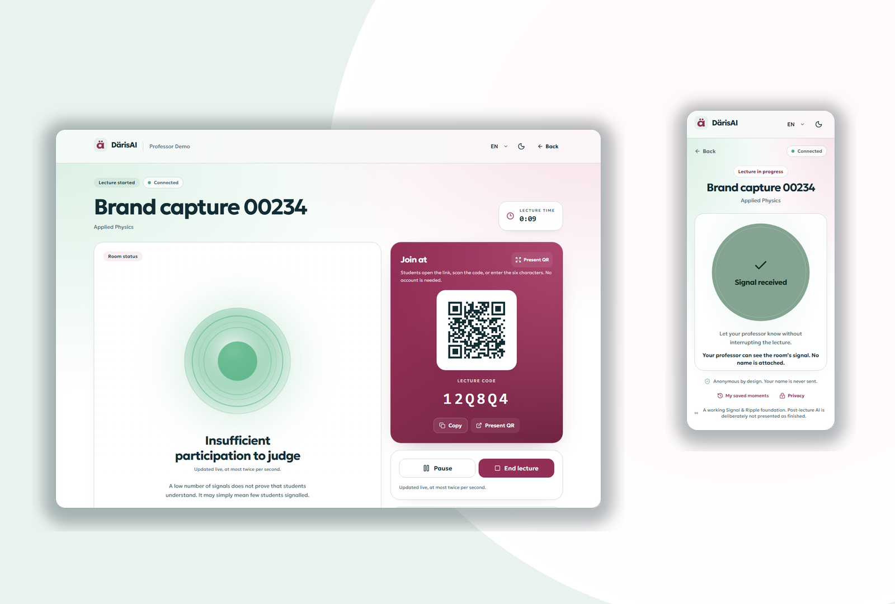

<table>
<tr>
<td width="60%" valign="top">
  
  <br /><sub><strong>Student-first landing</strong> — join with a code, no account.</sub>
</td>
<td width="40%" valign="top">
  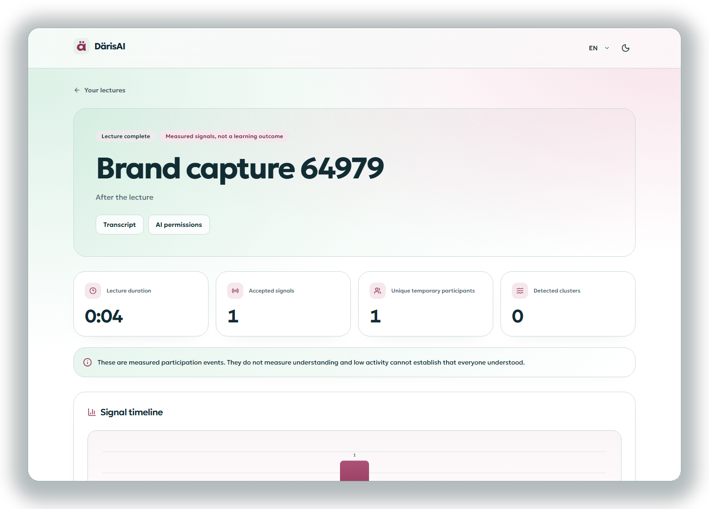
  <br /><sub><strong>After the lecture</strong> — factual aggregates, not inferred understanding.</sub>
</td>
</tr>
</table>

<table>
<tr>
<td width="50%" valign="top">
  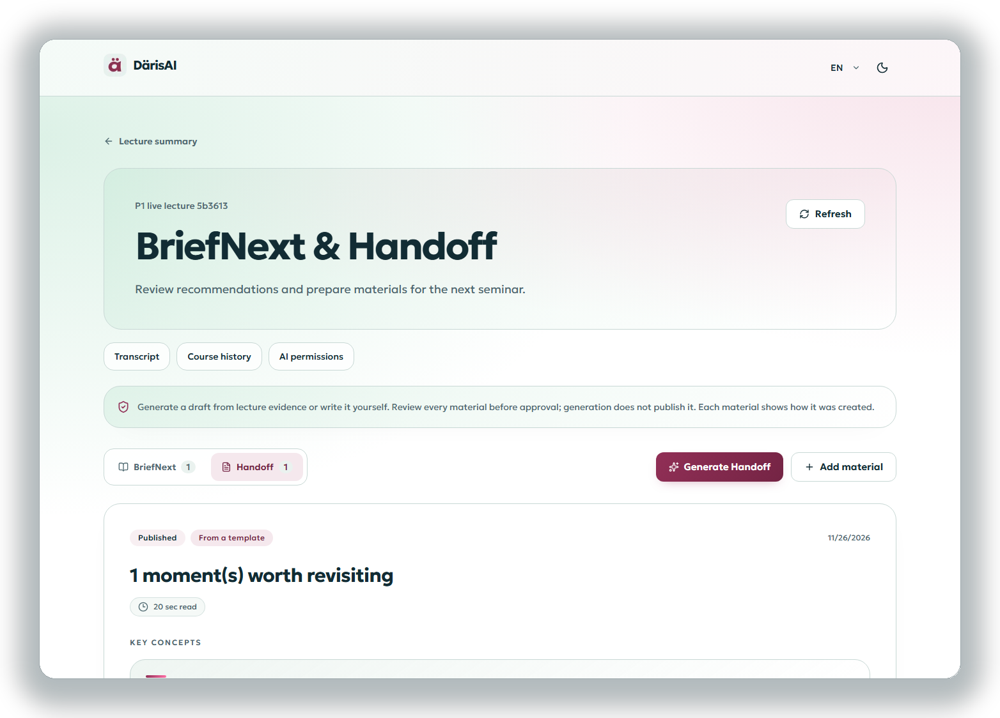
  <br /><sub><strong>BriefNext / Handoff</strong> — evidence, decisions and approval before publication.</sub>
</td>
<td width="50%" valign="top">
  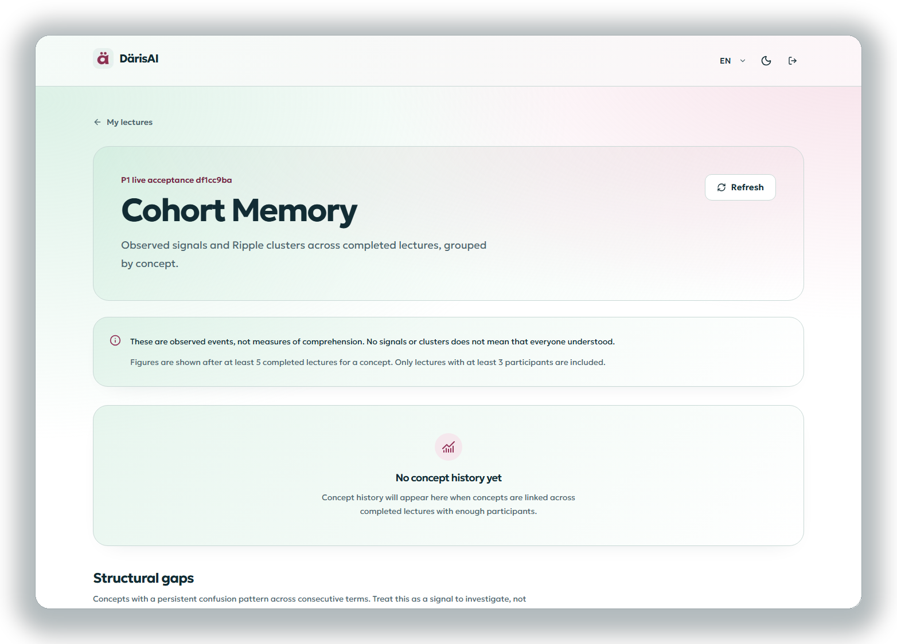
  <br /><sub><strong>Cohort Memory</strong> — observed signals, structural gaps and explicit provenance.</sub>
</td>
</tr>
<tr>
<td colspan="2" valign="top">
  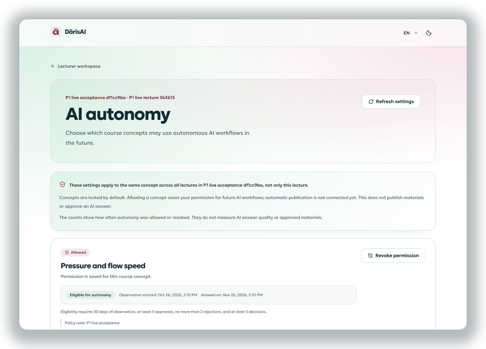
  <br /><sub><strong>Staged autonomy</strong> — locked by default; eligibility is server-authoritative.</sub>
</td>
</tr>
</table>

<p align="center"><sub>Also see the landing in <a href="brand/readme/gallery/landing-dark.png">dark mode</a> and <a href="brand/readme/gallery/landing-mobile.png">mobile</a>.</sub></p>

<table>
<tr>
<td width="50%" valign="top">
  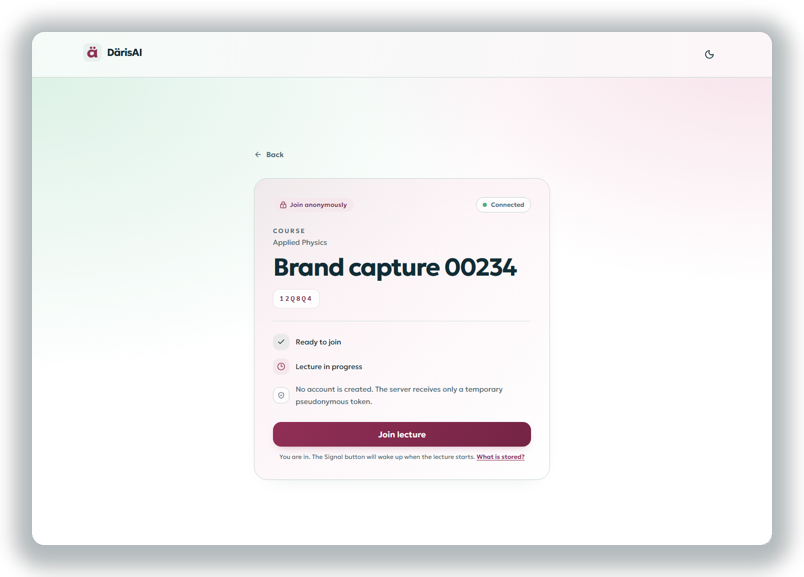
  <br /><sub><strong>Join</strong> — code first, no account.</sub>
</td>
<td width="50%" valign="top">
  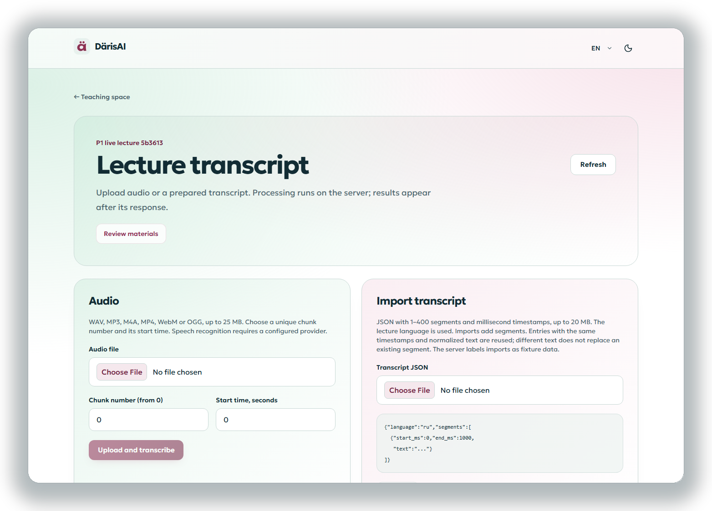
  <br /><sub><strong>Transcript</strong> — grounded lecture context for Replay and Axiom.</sub>
</td>
</tr>
<tr>
<td valign="top">
  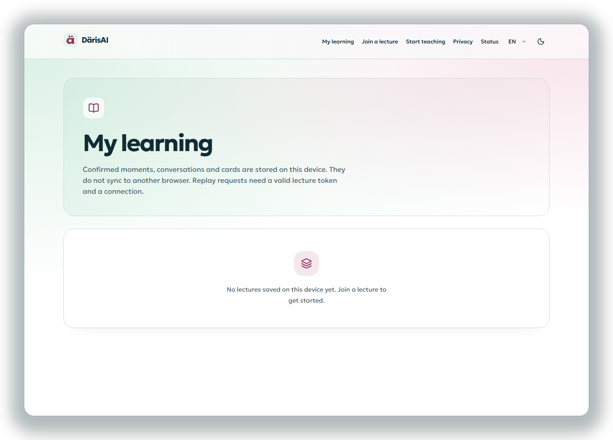
  <br /><sub><strong>Learning library</strong> — local cards, offline review and deletion.</sub>
</td>
<td valign="top">
  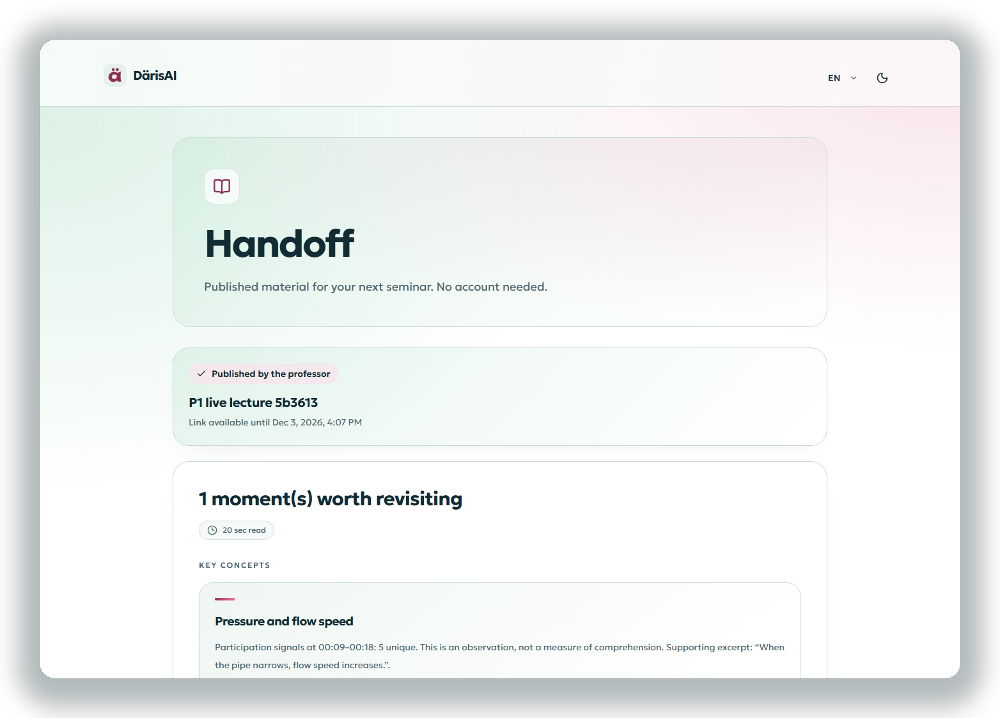
  <br /><sub><strong>Handoff</strong> — fragment credential, no account, no teacher data.</sub>
</td>
</tr>
<tr>
<td colspan="2" valign="top">
  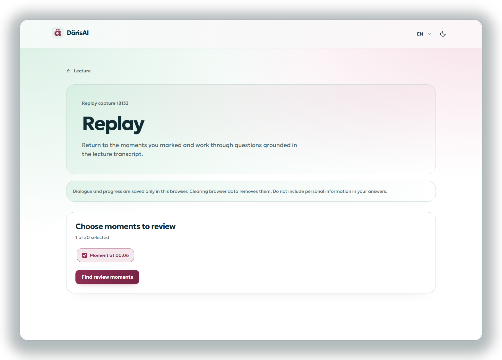
  <br /><sub><strong>Socratic Replay</strong> — revisit a confirmed local moment and work through a grounded question.</sub>
</td>
</tr>
</table>

## The product loop


The realtime path is deterministic and browser-free. No LLM sits in the Signal в†’ Ripple hot path. A lecture-scoped Signal Token can only send live signals; a Replay Token can only open Replay and GapCards.

## Signal в†’ Ripple


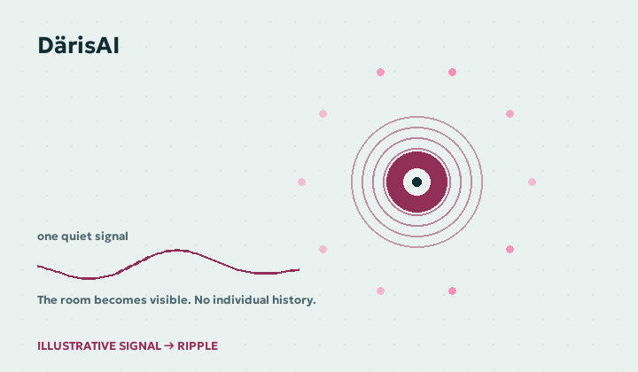

**20-second window · EWMA α = 0.4 · hysteresis · ≤ 2 broadcasts/second.** Silence is `few_signals`, never proof of understanding. Small groups stay `insufficient_participation`.

## A local-first intelligence layer

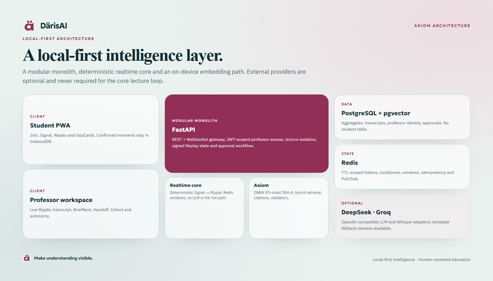

- **Axiom** — real `intfloat/multilingual-e5-small` ONNX embeddings, 384 dimensions, CPU inference; timestamped transcript ingestion; lecture-isolated hybrid retrieval (dense + BM25 + weighted RRF + temporal RRF).
- **Grounded generation** — citations, groundedness, answer-leak and prompt-injection validation. DeepSeek and Groq are optional; template fallback remains explicit as `source=template`.
- **Teacher intelligence** — BriefNext, Handoff, approval history, deterministic clusters and cohort gaps.
- **Privacy boundary** — no student table, no persistent student dialogue and no raw audio. Professor identity remains the only persistent personal identity.

## Built for real classrooms

- Anonymous join with separately scoped **Signal** and **Replay** tokens.
- Real WebSocket gateway with Origin checks, heartbeats, rate limits and message bounds.
- Atomic Redis windows, duplicate rejection and cooldown enforcement.
- Deterministic Ripple with small-group policy and a 2 Hz broadcast cap.
- Persisted confusion clusters and factual minute-level analytics.
- QR presentation, post-lecture summary, privacy manifest and component status.
- EN / RU / KK, light and dark themes, keyboard and reduced-motion support.
- PWA shell with local IndexedDB study history and offline card review.
- Socratic Replay, GapCards and teacher-approved BriefNext / Handoff.

## Verified engineering

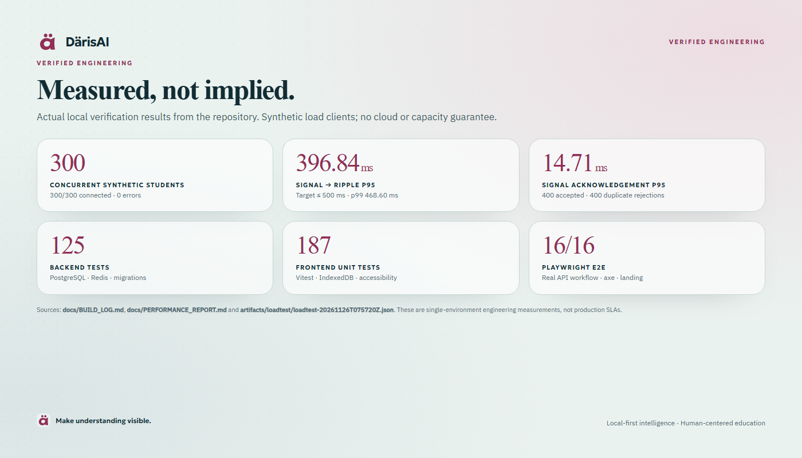

| Check | Actual local result |
| --- | --- |
| Backend | **127 tests passed** В· Ruff and mypy clean |
| Frontend | **188 unit tests passed** in 17 files |
| Browser | **16/16 Playwright E2E** including real API Signal в†’ Ripple and axe |
| Signal acknowledgement | p95 **14.71 ms** |
| Signal → Ripple | p95 **396.84 ms**, p99 468.60 ms · target ≤ 500 ms |
| 300-client synthetic load | 300/300 connected В· **0 errors** В· 400 accepted / 400 duplicate rejections |
| Production build | Next.js production build passed |
| Contracts | OpenAPI and TypeScript generation stable |

Sources: [`docs/BUILD_LOG.md`](docs/BUILD_LOG.md), [`docs/PERFORMANCE_REPORT.md`](docs/PERFORMANCE_REPORT.md), [`artifacts/loadtest/loadtest-20261126T075720Z.json`](artifacts/loadtest/loadtest-20261126T075720Z.json).

These are single-environment engineering measurements, not production SLAs. Docker and permanent cloud deployment were not executed locally. A temporary HTTPS competition demonstration was verified after integration; see [final publication evidence](docs/FINAL_PUBLICATION.md).

## Quick start

### Local — verified

Requirements: Python 3.12+, Node 24, pnpm, PostgreSQL 16+ with `pgvector`, Redis 5+.

```bash
cp .env.example .env

cd backend
python -m venv .venv
# Windows: .\.venv\Scripts\python -m pip install -e ".[dev]"
# Unix:    source .venv/bin/activate && pip install -e ".[dev]"
python -m app.migrate
python -m app.seed
python -m uvicorn app.main:app --host 127.0.0.1 --port 8000
```

```bash
cd frontend
pnpm install --frozen-lockfile
pnpm dev
```

Open <http://localhost:3000>, use the development invite code **`DARIS-TEACH-2026`**, and create a lecture. See [`docs/ONBOARDING.md`](docs/ONBOARDING.md) for the full path.

### Docker

```bash
cp .env.example .env
docker compose up --build
```

The Compose files are committed, but Docker was not available in the verification environment. This path is **not claimed as locally tested**.

### Local AI

The core lecture loop does not call an LLM. Local Faster-Whisper `small` CPU INT8 transcription is verified for EN/RU/KK; Kazakh output is imperfect. Ollama `qwen2.5:1.5b` verification is partial: BriefNext and Handoff returned live local generation, while Replay start and GapCards used templates; a local Replay turn took 147.92 s. The local adapter does not silently switch to a cloud provider. DeepSeek remains an optional server-configured interactive provider. See [`docs/LOCAL_AI.md`](docs/LOCAL_AI.md) for evidence and latency limits.

## Repository map

```text
backend/    FastAPI В· WebSocket В· PostgreSQL/pgvector В· Redis В· Axiom В· tests
frontend/   Next.js 16 В· PWA В· design system В· Replay В· GapCards В· E2E
brand/      official logo, icons, hero, diagrams, screenshots and social preview
docs/       architecture В· API В· DB В· security В· handovers В· reports В· ADRs
scripts/    contract export В· brand asset generation В· smoke В· load test
artifacts/  raw synthetic load and evaluation evidence
```

## Documentation

- [Architecture](ARCHITECTURE.md) — containers, sequences, token boundaries
- [API contracts](docs/API_CONTRACTS.md) — REST and WebSocket protocol
- [Database schema](docs/DB_SCHEMA.md) — aggregates, privacy rules, migrations
- [Security & privacy](docs/SECURITY_PRIVACY.md) — threat model and honest limits
- [P1 frontend handover](docs/handover/P1.md) — screens, accessibility, real integration
- [P2 backend handover](docs/P2_HANDOVER.md) — cohort, autonomy, Handoff, demo backend
- [P3 Axiom handover](docs/P3_HANDOVER.md) — retrieval, providers, guardrails
- [Local AI](docs/LOCAL_AI.md) — verified local STT, partial local LLM evidence and latency limits
- [Final publication](docs/FINAL_PUBLICATION.md) — merge, main CI/E2E and temporary demo verification
- [AI production readiness](docs/AI_PRODUCTION_READINESS.md) — prewarm, cache, cost, limits
- [Performance report](docs/PERFORMANCE_REPORT.md) — 300-client methodology
- [Retrieval benchmark](docs/RETRIEVAL_BENCHMARK.md) — dense vs lexical vs hybrid
- [Developer onboarding](docs/ONBOARDING.md) — setup, tests and contribution path
- [Judge demo](docs/JUDGE_DEMO.md) — real 40-student backend orchestration
- [Deployment](docs/DEPLOYMENT.md) — Docker, environment and current infrastructure blocker
- [Smartphone acceptance](docs/SMARTPHONE_ACCEPTANCE.md) — manual device checklist
- [Brand guide](docs/BRAND.md) — palette, logo, typography and asset rules
- [Build log](docs/BUILD_LOG.md) — actual commands and results
- [Русский README](README.ru.md) · [Қазақша README](README.kk.md)

## Judge demo

The real 40-student orchestration is reproducible with [`scripts/judge_demo.py`](scripts/judge_demo.py): 40 synthetic WebSocket clients, real Ripple, Replay/GapCards, template BriefNext/Handoff, Cohort Memory and a reset. Actual 90-second evidence: 40/40 students, 40 accepted signals, 41 Ripple updates, 87.53 s. See [`docs/JUDGE_DEMO.md`](docs/JUDGE_DEMO.md).

## Privacy in one paragraph

A temporary Signal Token is pseudonymous, not proof of absolute anonymity. The server stores only token hashes in Redis, never in PostgreSQL. There is no student account, name, email, phone, device ID or individual signal history. Confirmed moments live in the student’s IndexedDB and can be cleared locally. Replay state is signed, not encrypted; a Replay Token is a capability, not a unique person. Read the [security and privacy note](docs/SECURITY_PRIVACY.md) or open `/privacy` in the app.

## Brand

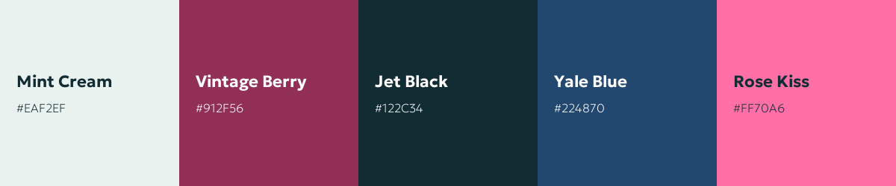

<p align="center"></p>

The official mark is the stylized lowercase **Г¤** in Vintage Berry on Mint Cream. Assets: [`brand/logo`](brand/logo) В· [`brand/icons`](brand/icons) В· [brand guide](docs/BRAND.md). Do not replace the mark with a generic AI sparkle, book, brain or chatbot icon.

## Status and limits

- вњ… Core lecture loop, anonymous join, Signal/Ripple, transcript, Replay, GapCards, BriefNext/Handoff, Cohort and autonomy are implemented and tested.
- вњ… Live DeepSeek and Groq provider smoke checks passed; local Ollama `qwen2.5:1.5b` generation was verified through the integrated API (33.69 s, `source=live`); template fallback remains deterministic.
- вњ… Local Faster-Whisper `small` CPU INT8 transcription was verified for EN/RU/KK through the real audio-chunk API; cloud Groq remains optional.
- вљ пёЏ Broad live adversarial safety evaluation and human learning-outcome studies are not established.
- вњ… Temporary HTTPS demonstration verified with real PostgreSQL, Redis, FastAPI, production Next.js, public WebSocket and explicit Origin checks. This is not permanent hosting.
- вљ пёЏ Permanent cloud hosting, multi-worker evaluator coordination and a real-device screen-reader audit are not claimed. Physical iPhone test step results remain unconfirmed.
- вљ пёЏ P4 owns the 40-student judge simulator and 90-second orchestration.

## Contributing

Read [`docs/ONBOARDING.md`](docs/ONBOARDING.md), keep the privacy invariants, add tests for behaviour, regenerate contracts, and run the local checks before opening a PR. Security reports: see [`SECURITY.md`](SECURITY.md).

## Team and license

Built by the DärisAI team. Released under the [MIT License](LICENSE). No institutional adoption, funding or customer claims are made.

<div align="center"><sub>DärisAI · Local-first intelligence. Human-centered education.</sub></div>

