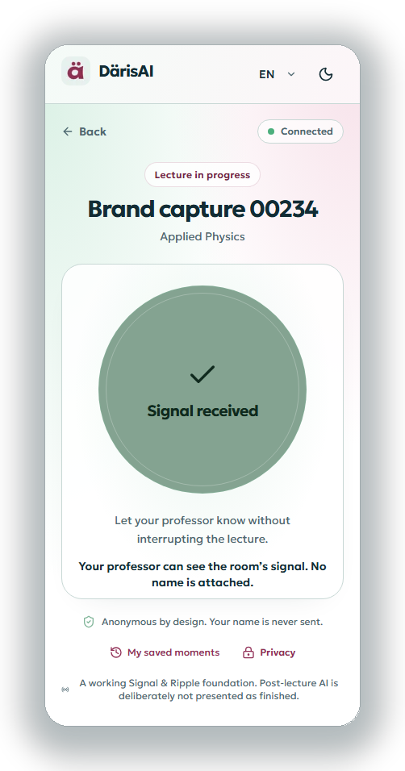
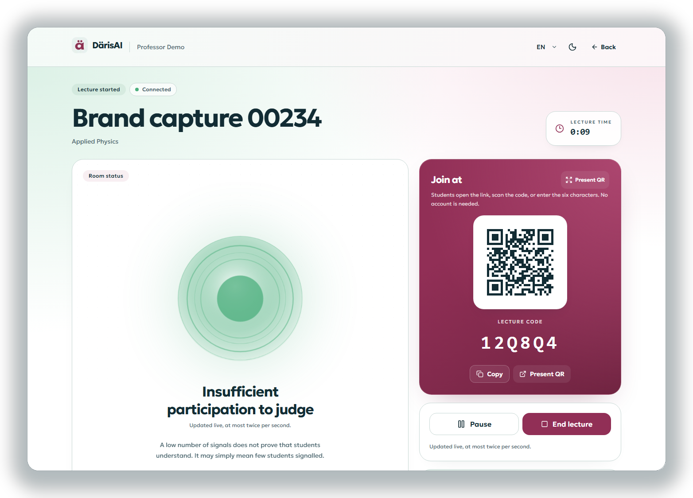

<div align="center">

<picture>
  <source media="(prefers-color-scheme: dark)" srcset="brand/readme/hero-dark.png">
  
</picture>

### Не всё понятно? Это нормально.

[English](README.md) · **Русский** · [Қазақша](README.kk.md)

[](https://github.com/Nurzhigittt/project-darisai/actions)
[](https://github.com/Nurzhigittt/project-darisai/actions)


**Локальный интеллект. Образование для людей.**

</div>

---

## Спокойнее понимать аудиторию

DärisAI — слой Classroom Intelligence для момента, когда студент теряет нить объяснения.

Студент открывает ссылку, вводит шесть символов и нажимает **«Я не понимаю»**, когда нуждается в пояснении. Преподаватель видит спокойный агрегированный Ripple, а не чат, рейтинг или профиль студента.

Без аккаунтов студентов. Без микрофона. Без индивидуальной истории сигналов.

| Для студентов | Для преподавателей | Для приватности |
| --- | --- | --- |
| Одна ссылка. Одно нажатие. Без регистрации и установки. | Понятный сигнал аудитории. Пауза, продолжение и возврат к моменту без выхода из лекции. | Только агрегаты. Подтверждённые моменты остаются в браузере студента. Постоянно хранится только личность преподавателя. |

## Как это выглядит

Это реальные скриншоты production-сборки из локального синтетического демо-прогона. Имена, названия лекций и числа — тестовые данные.

<table>
<tr>
<td width="60%"><br /><sub>Студенческий лендинг: вход по коду без аккаунта.</sub></td>
<td width="40%"><br /><sub>Одно тихое действие и локальное подтверждение.</sub></td>
</tr>
<tr>
<td><br /><sub>QR, код и агрегированный Ripple.</sub></td>
<td><br /><sub>Фактические агрегаты, а не оценка понимания.</sub></td>
</tr>
</table>

## Цикл продукта


Реальный путь детерминирован: **20-секундное окно Redis → EWMA α = 0.4 → гистерезис → не более 2 трансляций в секунду**. LLM не находится в горячем пути Signal → Ripple.

## Локальная архитектура


- **Axiom** — реальные ONNX-эмбеддинги `multilingual-e5-small`, 384 измерения, CPU; гибридный поиск dense + BM25 + RRF + temporal.
- **Обоснованная генерация** — цитаты, groundedness, защита от утечки ответа и prompt injection.
- **Провайдеры** — DeepSeek и Groq опциональны; шаблонный fallback честно помечается `source=template`.
- **Приватность** — нет таблицы студентов, постоянных диалогов и сырого аудио.

## Проверено


| Проверка | Фактический локальный результат |
| --- | --- |
| Backend | **127 тестов** · Ruff и mypy чистые |
| Frontend | **188 unit-тестов** в 17 файлах |
| Playwright | **16/16 E2E**, включая реальный Signal → Ripple и axe |
| Signal acknowledgement | p95 **14.71 мс** |
| Signal → Ripple | p95 **396.84 мс**, p99 468.60 мс |
| Нагрузка | 300/300 клиентов · **0 ошибок** |
| Production build | Успешно |

Это измерения одной локальной среды, не SLA. Docker и облако локально не запускались.

## Быстрый старт

```bash
cp .env.example .env

cd backend
python -m venv .venv
python -m pip install -e ".[dev]"
python -m app.migrate
python -m app.seed
python -m uvicorn app.main:app --host 127.0.0.1 --port 8000
```

```bash
cd frontend
pnpm install --frozen-lockfile
pnpm dev
```

Откройте <http://localhost:3000>, используйте dev-код **`DARIS-TEACH-2026`** и создайте лекцию. Полный путь — в [онбординге](docs/ONBOARDING.md).

## Документация

- [Архитектура](ARCHITECTURE.md) · [API](docs/API_CONTRACTS.md) · [База данных](docs/DB_SCHEMA.md)
- [Безопасность и приватность](docs/SECURITY_PRIVACY.md)
- [P1 frontend](docs/handover/P1.md) · [P2 backend](docs/P2_HANDOVER.md) · [P3 Axiom](docs/P3_HANDOVER.md)
- [Онбординг](docs/ONBOARDING.md) · [Локальный AI](docs/LOCAL_AI.md) · [Настройка провайдеров](docs/AI_PROVIDER_SETUP.md)
- [Бренд](docs/BRAND.md) · [Build log](docs/BUILD_LOG.md)

## Приватность

Signal Token псевдонимный, но это не абсолютная анонимность: им может воспользоваться любой, у кого он есть, до истечения срока. Сервер хранит только хэши токенов в Redis, не в PostgreSQL. Нет аккаунтов, имён, email, телефонов, device ID или индивидуальной истории сигналов. Подтверждённые моменты хранятся в IndexedDB студента и удаляются локально.

## Бренд

Официальная палитра: **Mint Cream `#EAF2EF`**, **Vintage Berry `#912F56`**, **Jet Black `#122C34`**, **Yale Blue `#224870`**, **Rose Kiss `#FF70A6`**. Официальный знак — строчная **ä** в Vintage Berry на Mint Cream. Не заменяйте его на generic AI-иконку.

## Статус и ограничения

- ✅ Основной цикл лекции, Replay, GapCards, BriefNext/Handoff, Cohort и автономность реализованы и проверены.
- ✅ Live-проверки DeepSeek/Groq пройдены; шаблонный fallback сохранён.
- ⚠️ Широкая live-проверка adversarial-безопасности и исследования учебных результатов не заявляются.
- ⚠️ Нет деплоя, облака, multi-worker и аудита со screen reader на реальных устройствах.
- ⚠️ P4 отвечает за симулятор 40 студентов и 90-секундную демонстрацию.

<div align="center"><sub>DärisAI · Локальный интеллект. Образование для людей.</sub></div>
