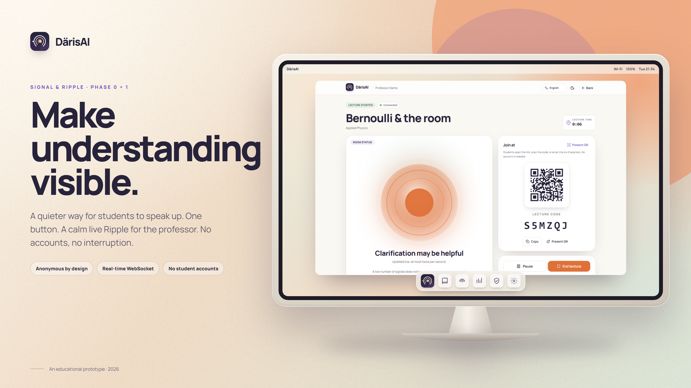
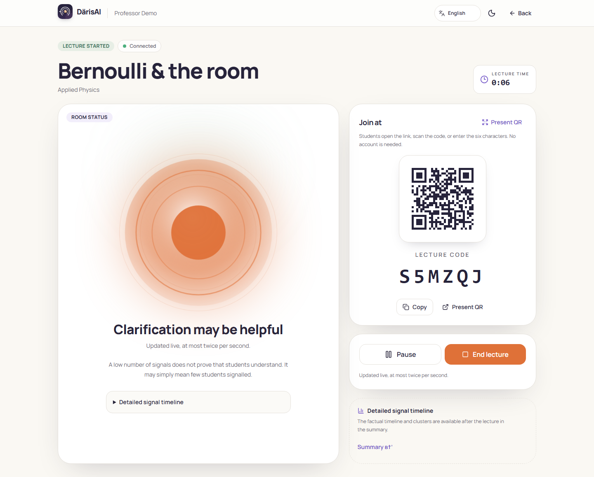
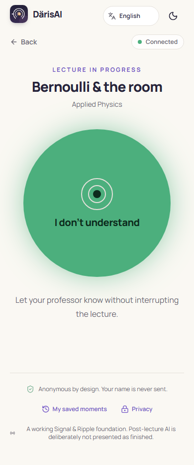
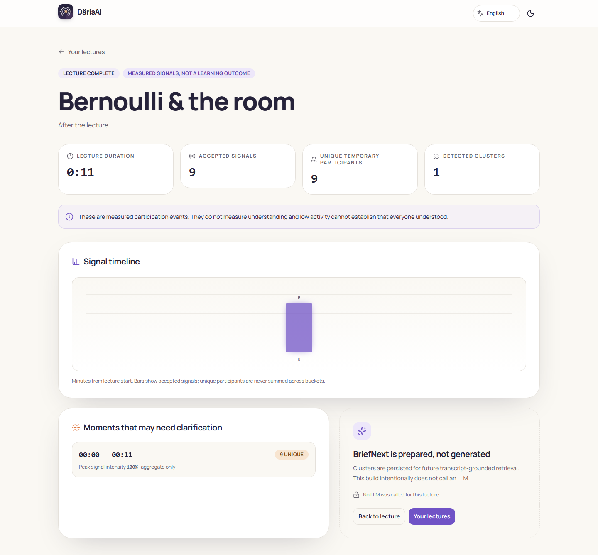
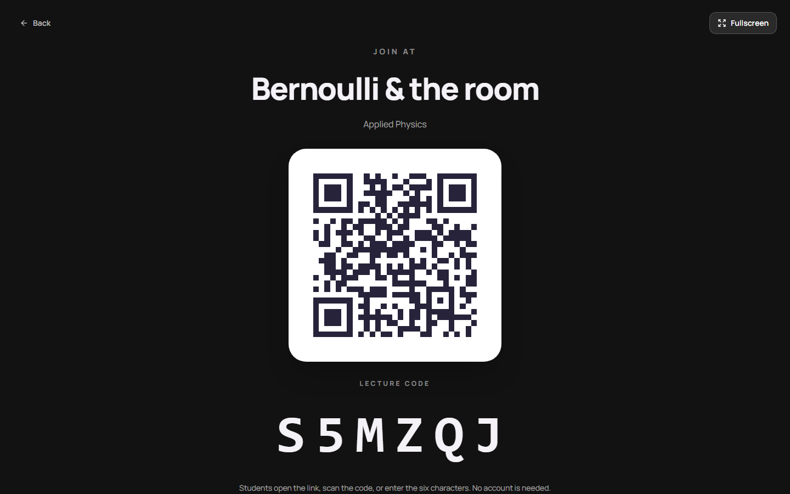

<div align="center">


# DärisAI

### Сделайте понимание видимым.

Тихий способ для студентов сказать о непонимании — и для преподавателя увидеть момент, когда аудитория теряет нить.

**Без аккаунтов студентов · Без прерывания лекции · Ripple в реальном времени**

[English](README.md) · **Русский**

[](https://github.com/Nurzhigittt/project-darisai/actions)


</div>



## Что это

DärisAI — рабочая вертикаль **Signal & Ripple** для лекций:

- студент открывает ссылку и вводит шестизначный код;
- аккаунт не создаётся;
- на экране одна большая кнопка **«Я не понимаю»**;
- преподаватель видит спокойную рябь, а не рейтинг или чат;
- после лекции остаётся фактическая сводка сигналов и кластеров.

Низкая активность **не** означает, что все всё поняли. Интерфейс так и говорит: «мало сигналов» или «недостаточно участия».

## Экраны

<table>
<tr>
<td width="58%"><br /><sub><strong>Преподаватель:</strong> тёплая рябь и понятный статус</sub></td>
<td width="42%"><br /><sub><strong>Студент:</strong> одна кнопка, без аккаунта</sub></td>
</tr>
</table>

<table>
<tr>
<td width="50%"><br /><sub><strong>После лекции:</strong> только измеренные события</sub></td>
<td width="50%"><br /><sub><strong>QR-режим:</strong> для проектора и аудитории</sub></td>
</tr>
</table>

## Быстрый старт

### Docker

```bash
cp .env.example .env
docker compose up --build
```

- Web: <http://localhost:3000>
- API: <http://localhost:8000>
- API docs: <http://localhost:8000/docs>

> Docker не был доступен в среде, где проверялась эта версия. Compose-файлы есть в репозитории, но Docker-путь **не заявлен как локально проверенный**.

### Локально — проверено

Нужны Python 3.12+, Node 24, pnpm, PostgreSQL 16+ с `pgvector`, Redis 5+.

```bash
cp .env.example .env

cd backend
python -m venv .venv
# Windows:
.\.venv\Scripts\python -m pip install -e ".[dev]"
.\.venv\Scripts\python -m app.migrate
.\.venv\Scripts\python -m app.seed
.\.venv\Scripts\python -m uvicorn app.main:app --host 127.0.0.1 --port 8000
```

```bash
cd frontend
pnpm install --frozen-lockfile
pnpm dev
```

## Как создать лекцию

1. Откройте **`/login`**.
2. Введите dev-инвайт **`DARIS-TEACH-2026`**  
   (значение `SEED_PROFESSOR_INVITE_CODE`; только для разработки).
3. Выберите курс, название и язык лекции.
4. Нажмите **Create lecture**.
5. DärisAI сам создаст **шестизначный код лекции** и QR-ссылку.
6. Студенты открывают ссылку или вводят код — без регистрации.

Преподаватель **не придумывает** код лекции. Если вход не работает, выполните `python -m app.migrate` и `python -m app.seed` заново.

QR строится из `APP_BASE_URL`. Перед созданием лекции для реального домена укажите его в `.env` и перезапустите backend.

## Что проверено

| Проверка | Результат |
| --- | --- |
| Backend | **37 тестов** на реальных PostgreSQL + Redis |
| Frontend | **11 тестов** |
| End-to-end | **7 тестов** Playwright, включая полный сценарий и axe |
| Сборка | Production build Next.js успешен |
| Нагрузка | 300/300 клиентов, 0 ошибок, Ripple p95 **493 ms** |
| Секреты | gitleaks — чисто локально |
| Docker / remote CI | настроены, но **не запускались здесь** |

Ripple p95 ниже цели 500 ms всего на 6,75 ms, а p99 выше 500 ms. Это измерение, а не гарантия SLA. Подробности — в [PERFORMANCE_REPORT.md](docs/PERFORMANCE_REPORT.md).

## Что реально реализовано

- Авторизация преподавателя по инвайту, жизненный цикл лекции, пауза/продолжение.
- Анонимный вход и раздельные **Signal Token** / **Replay Token**.
- Аутентифицированный WebSocket: hello timeout, проверка роли, лекции, Origin, лимиты.
- Атомарная обработка сигналов в Redis: идемпотентность, cooldown, окно.
- Детерминированный Ripple: EWMA, гистерезис, малые группы, не более 2 обновлений/с.
- Сохранение кластеров, 10-секундные бакеты и минутная аналитика.
- Локальная история подтверждённых сигналов в IndexedDB.
- QR-режим, итоги лекции, privacy manifest, статус, PWA.
- EN / RU / KK, светлая и тёмная темы, доступные состояния кнопки.

## Что не выдаётся за готовое

STT, Temporal RAG, Socratic Replay, GapCards, BriefNext, Handoff, Cohort Memory и полный demo-сценарий на 90 секунд **не реализованы**. LLM в этой фазе не вызывается.

## Документация

- [Аудит спецификации](docs/SPEC_AUDIT.md)
- [Архитектура](ARCHITECTURE.md)
- [API-контракты](docs/API_CONTRACTS.md)
- [Схема БД](docs/DB_SCHEMA.md)
- [Безопасность и приватность](docs/SECURITY_PRIVACY.md)
- [ADR](docs/adr/)
- [Roadmap](docs/ROADMAP.md)
- [Handover](docs/HANDOVER.md)

## Приватность

Нет таблицы студентов, имени, email, телефона или истории отдельных сигналов в PostgreSQL. Signal Token — псевдонимный временный ключ, а не доказательство абсолютной анонимности: тот, у кого он есть, может действовать от имени участника до истечения срока. Очистка данных браузера удаляет локальную историю.

## Лицензия

MIT — [LICENSE](LICENSE).

<div align="center">
  <sub>Venture Startup Battle 2026 · Signal & Ripple foundation</sub>
</div>
