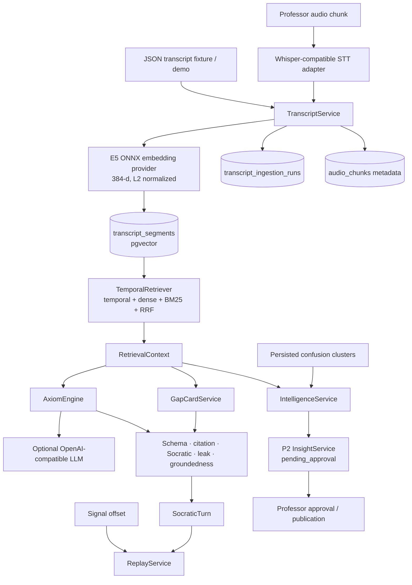

# Axiom architecture

**Status:** Phase 3 working slice. Phase 4 template integration. Live AI providers are implemented but unverified without credentials.

Axiom is the AI layer behind Socratic Replay, GapCards and teacher intelligence. It is additive to the Phase 1 Signal & Ripple path: no AI call sits on the WebSocket signal hot path.

## Components



## Transcript ingestion

1. Validate lecture ownership, timestamp interval, text, language and size.
2. Normalize text and compute a content hash.
3. Generate `passage:` embeddings in bounded batches through ONNX Runtime.
4. Upsert into `transcript_segments` on `(lecture_id, content_hash)`, so re-uploading the same segment does not duplicate it.
5. If embeddings fail, persist text with `embedding NULL` and mark the run `degraded`. Retrieval then falls back to temporal-only mode; it never substitutes fake vectors in production.

The ONNX model is `intfloat/multilingual-e5-small`, 384 dimensions, cosine distance, `vector_cosine_ops`. The model file is `onnx/model_O4.onnx` (quantized; full FP32 produced identical evaluation metrics). It is lazily downloaded into the ignored `.model_cache/` directory and loaded once, off the event loop. `AXIOM_EMBEDDING_PREWARM=true` loads it during startup and reports failure without killing lexical/temporal retrieval.

## Temporal RAG

For a focus offset `T`:

```text
window_start = max(0, T - 90_000)
window_end   = T + 10_000
```

- Temporal candidates: segments overlapping this window, restricted by `lecture_id`.
- Dense candidates: exact filtered cosine search over the same lecture, top 16.
- Lexical candidates: BM25 over lecture text with a language-neutral prefix stemmer and a lecture-grounded multilingual alias vocabulary, top 16.
- Fusion: weighted Reciprocal Rank Fusion (k=60) plus a temporal-window RRF term; final top-k 4.
- Deduplicate by segment UUID, preserve canonical timestamps and text, and bound the context by characters.
- `evidence_sufficient=false` returns an explicit refusal; the LLM is not called unnecessarily.

The corpus is small, so exact filtered cosine search is used instead of assuming a global HNSW scan will return four relevant results after lecture filtering. `AXIOM_RETRIEVAL_MODE=dense` preserves the previous baseline.

## Validation pipeline

```text
Retrieve context
  → check evidence sufficiency
  → generate structured JSON (optional LLM)
  → Pydantic schema validation
  → deterministic citation validation
  → Socratic behavior validation
  → answer-leak validation (rules + optional judge)
  → groundedness (deterministic + optional judge)
  → return validated turn
  → on failure: one stricter retry, then transcript-only template fallback
```

Every citation is checked against the retrieval context: same lecture, known segment ID, timestamp inside the segment, quote nonempty, ≤200 characters, and normalized substring match. The LLM never receives a segment it cannot cite.

## Replay state

Replay is stateless server-side:

- `mom1.*` signed moment references bind lecture, offset, window, concept and expiry.
- `sst1.*` signed state binds lecture, moment, stage, turn and expiry.
- Replay Token authenticates access; Signal Token cannot.
- History is client-supplied and bounded; server progress lives only in the signed state token.
- No student conversation table exists.

## GapCards and teacher intelligence

GapCards are generated from signed moments and verified transcript evidence. They are returned on demand; no student-specific card history is stored.

BriefNext/Handoff are generated from persisted confusion clusters, deterministic counts and verified transcript quotes. The P3 adapter calls P2's `InsightService.create_generated`, which always inserts `pending_approval`. P3 does not auto-publish Handoff content.

## Failure behavior

| Failure | Behavior |
| --- | --- |
| Embedding runtime/model unavailable | Transcripts persist without vectors; run `degraded`; temporal retrieval still works |
| No transcript evidence | Explicit refusal; no LLM call |
| LLM disabled / no key | Deterministic template from verified quote, `source=template` |
| LLM timeout or invalid JSON | One stricter retry if configured, then template fallback |
| Fabricated citation or unsupported claim | Rejected; fallback, never returned as live |
| Budget exhausted | HTTP 429 `AI_BUDGET_EXHAUSTED` |
| Per-token request limit | HTTP 429 `AI_RATE_LIMITED` |
| Reused signed state | HTTP 409 `REPLAY_STATE_REPLAYED` |
| Replay Token from another lecture | HTTP 401 |
| Tampered/expired state | HTTP 400 `REPLAY_STATE_INVALID` / `REPLAY_STATE_EXPIRED` |
