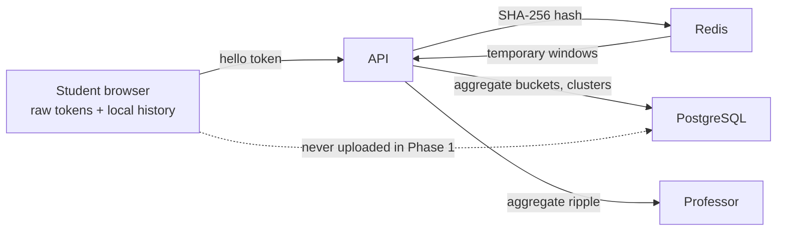

# Security and privacy model

This document describes the implemented Phase 0/1 controls. It is deliberately specific about what is and is not protected.

## 1. Threat model

| Threat | Assets | Mitigation | Residual risk |
| --- | --- | --- | --- |
| Token forgery | Join code, live signals | HMAC-SHA256 over scoped payload; constant-time compare; expiry; signature tests | Secret compromise breaks all tokens; rotate both secrets |
| Token theft | Student participation | Short Signal Token TTL, lecture binding, no URL exposure, TLS assumed in deployment | Bearer token can be replayed until expiry; possession is pseudonymous identity |
| Cross-lecture access | Lecture data | Token `lecture_id` claim, DB ownership checks, WS `lecture_id` equality, Pub/Sub channels | A compromised signing secret could mint cross-lecture tokens |
| Professor takeover | Lecture control | Invite hashing, JWT signature/issuer/audience/expiry, ownership lookup, rate-limited login | No MFA or refresh-token revocation in Phase 1 |
| Signal spam | Ripple integrity | 15 s cooldown, per-connection token bucket, idempotency, size limits, keyed IP join limits | Many tokens/devices can still signal; no human identity verification |
| Duplicate/replay | Metrics | Atomic Lua idempotency `(token_hash, client_seq)`, 1 h retention, duplicate ack | A new sequence can submit again after cooldown by design |
| Stale offline signals | Ripple accuracy | 30 s `client_ts_ms` bound, explicit `stale_signal`, bounded local queue | Device clock skew is not fully controllable |
| WS flood / DoS | Availability | Hello deadline, max message size, rate limit, idle timeout, capped connections per process | No global L3/L7 DDoS protection in local setup |
| Redis memory growth | Availability | TTLs on all keys, bounded cooldown/idempotency, flush of buckets | Very large lectures can still increase ZSET/window memory |
| Log leakage | Privacy | JSON formatter allowlist; no bodies/cookies/headers/IPs/tokens; access log disabled | Exceptions may include internal query text; review logs before sharing |
| Browser storage access | Local history | IndexedDB same-origin isolation; no API history upload | XSS or a compromised dependency could read local tokens |
| CSRF | Professor actions | Bearer token in Authorization header, not cookie; CORS allowlist | XSS remains a stronger threat |
| Prompt injection (future) | Axiom output | Transcript treated as untrusted; strict schema; citation/grounding/answer-leak checks; template fallback | No model is called in Phase 1; validators reduce rather than eliminate error |
| Hallucination / overtrust (future) | Pedagogical safety | Citations, groundedness threshold, teacher approval default, refusal/template paths | Retrieval-grounded output can still be wrong; supervision required |
| Secret in repository | All | `.gitignore`, `.env.example` only, gitleaks in CI, production secret validation | Local environment files can still leak outside Git |
| Dependency compromise | Supply chain | Lockfiles, pinned versions, pnpm supply-chain policy, CI audits | No formal SBOM/signing in Phase 1 |

## 2. Credential lifecycle

### Professor

1. Development seed stores only `HMAC-SHA256(TOKEN_SIGNING_SECRET, normalized invite)`.
2. Login compares the digest and issues an HS256 JWT:
   - `sub` professor UUID, `role=professor`, `typ=professor_access`.
   - `iss` and `aud` required.
   - 12-hour default expiry.
3. REST dependencies and the WebSocket hello verify signature, claims, expiry and ownership.
4. The browser holds the JWT in `localStorage`; logout clears it. Expiry returns the user to login.

**Limitation:** no refresh-token rotation, server-side revocation, MFA or device management.

### Student Signal Token

1. `POST /join` generates a 128-bit random token ID inside an HMAC-signed payload.
2. Claims: `scp=signal`, `lid`, `iat`, `exp`, `jti`.
3. Redis stores only `sha256(token)` with metadata and a 4-hour TTL.
4. WebSocket hello verifies the HMAC, expiry, scope, lecture, then checks the Redis hash exists.
5. Tokens are never placed in URLs or logged.

### Student Replay Token

1. Independently signed `scp=replay`, 24-hour TTL.
2. Stateless; not stored in PostgreSQL.
3. Cannot validate as a Signal Token or authorize the student WebSocket.
4. Reserved for future replay endpoints; no endpoint accepts it yet.

### Session and local persistence

- IndexedDB holds the raw temporary credentials, lecture metadata, confirmed offsets and pending bounded signals.
- A server acknowledgement is required before a signal enters confirmed history.
- Pending offline signals older than 30 seconds are removed and never submitted.
- Clearing browser data removes all of this.

## 3. Authentication and authorization boundaries

| Boundary | Rule |
| --- | --- |
| REST professor routes | Bearer JWT + `lecture.professor_id` or `course.professor_id` |
| WS student | Signal scope + Redis hash + exact lecture ID |
| WS professor | JWT + lecture ownership |
| Lecture control | `VALID_TRANSITIONS` + owner check; terminal `ended` |
| Cross-lecture | Token lecture and envelope lecture must match connection |
| Redis Pub/Sub | Server-only channels; no client subscribe API |
| Privacy manifest | Public, schema-derived, no values or secrets |
| Status/metrics | Public operational data; no tokens, lectures or stable student IDs |

## 4. Rate limiting and abuse controls

- `/join`: keyed HMAC of IP + UTC date, 300/min default (classroom NAT consideration), 60 s Redis TTL.
- `/auth/professor`: keyed HMAC of IP + date, 10/min default.
- WebSocket: 10 messages/s with burst 20 per connection; close 4429.
- Signal: one accepted signal per 15 s per token.
- WS: hello within 3 s, 4 KB message cap, 75 s idle timeout.
- No permanent IP or device identifier is stored.
- Join-code rotation UI is deferred; six characters are human-friendly but not a strong secret.

## 5. Privacy manifest semantics

`GET /api/v1/privacy/manifest` is generated from `information_schema` at request time. It lists:

- actual tables and columns;
- purposes;
- `not_collected`;
- temporary credential policies;
- retention;
- limitations;
- verification steps;
- allowlisted personal fields (`professors.name` only).

It fails closed if the schema violates the allowlist. It describes schema-level storage, not a legal certification. The UI renders this manifest on `/privacy`.

## 6. Data flow

- No audio is ingested or stored.
- No third-party analytics, advertising or LLM provider is called in Phase 1.
- The IP is used transiently for keyed rate limiting and never logged or stored in PostgreSQL.

## 7. Secure configuration

- Production startup requires HTTPS `APP_BASE_URL`, strong secrets, `AUTO_SEED=false` and no example JWT values.
- CORS and WS origins must be configured explicitly.
- Docker containers run as non-root.
- Secrets come from environment variables; `.env` is ignored by Git.
- CI runs gitleaks, Ruff, mypy, tests, contract drift, frontend checks and Playwright.

## 8. Known security/privacy limitations

1. Bearer tokens are pseudonymous credentials, not proof of a unique human.
2. Multi-browser/multi-device participation cannot be deduplicated.
3. No MFA, refresh-token rotation or JWT revocation list.
4. No global DDoS protection, WAF or managed Redis/PostgreSQL hardening is included.
5. No formal penetration test, threat-model sign-off or manual screen-reader audit has been completed.
6. Prompt-injection defenses are interfaces and documented design, not implemented LLM behavior.
7. Docker images and remote CI have not been executed in the build environment; see the handover.
8. Service-worker caching is intentionally limited to the app shell; API responses and credentials are never cached.

## P2 completion controls

- Canonical concepts/decision history store aggregate metadata and professor decisions only; no student identity or dialogue.
- Handoff links store SHA-256 hashes, enforce expiry/revocation, revoke older links on republish/edit/reject, count redemptions and rate-limit the public redeem route.
- Insight decisions are append-only audit rows; content hashes are for integrity, not content storage.
- Demo lectures require an owned `demo_sessions` row and `is_demo=true`; reset/delete cannot touch real lectures. Expiry cleanup is scoped to the professor.
- Autonomy is locked by default; whitelisting requires explicit professor action plus 30-day observation, 5 approvals, at most 2 rejections and 5 decisions. No automatic publication path bypasses approval.
- Cohort structural gaps are labeled `synthetic`, `observed` or `mixed`; synthetic seed rows are not presented as real institutional history.
- All new queries are parameterized and ownership-scoped.
- Remaining risks: signed Replay state is replayable until expiry except the single-use nonce; a Replay Token is pseudonymous, not a unique person; provider retention is outside backend control.
